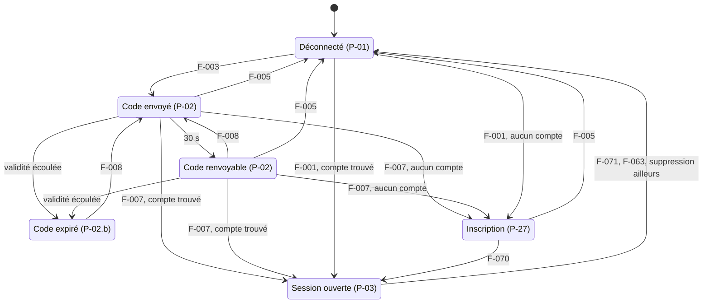
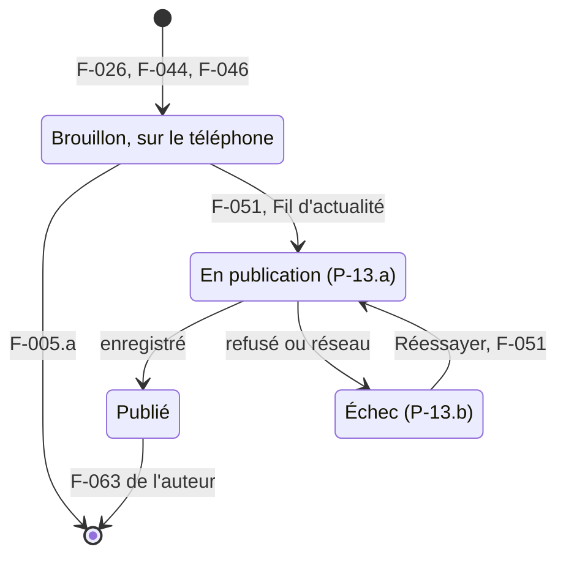
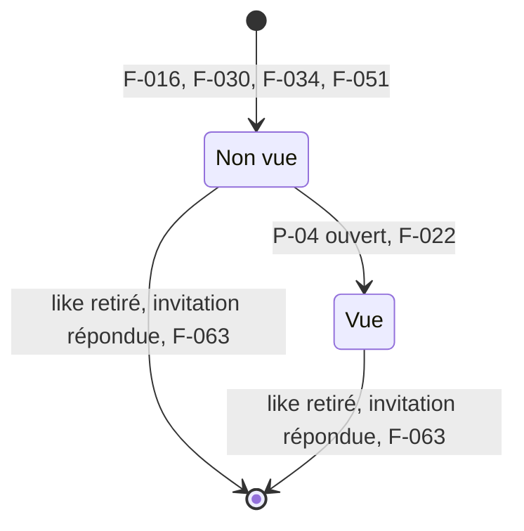
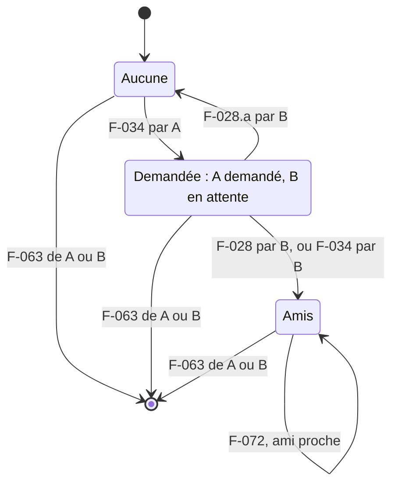
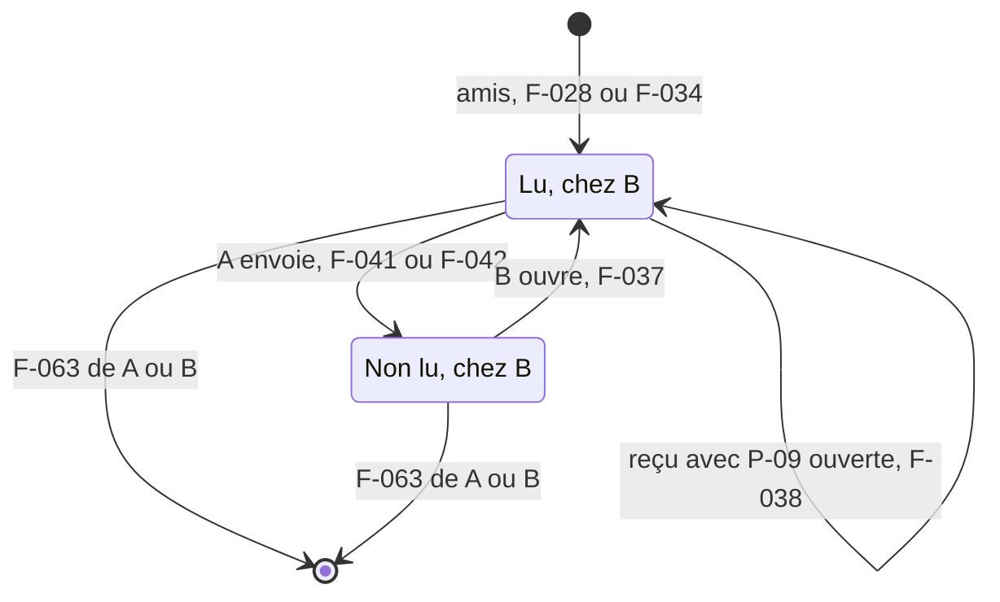
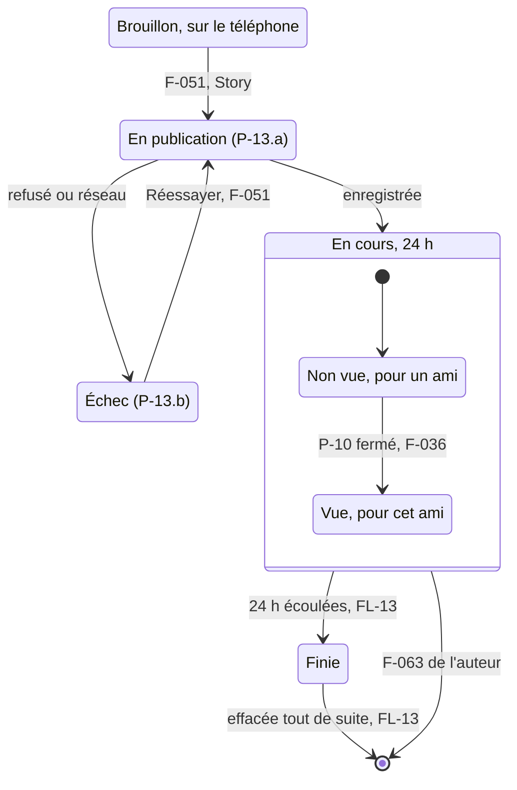
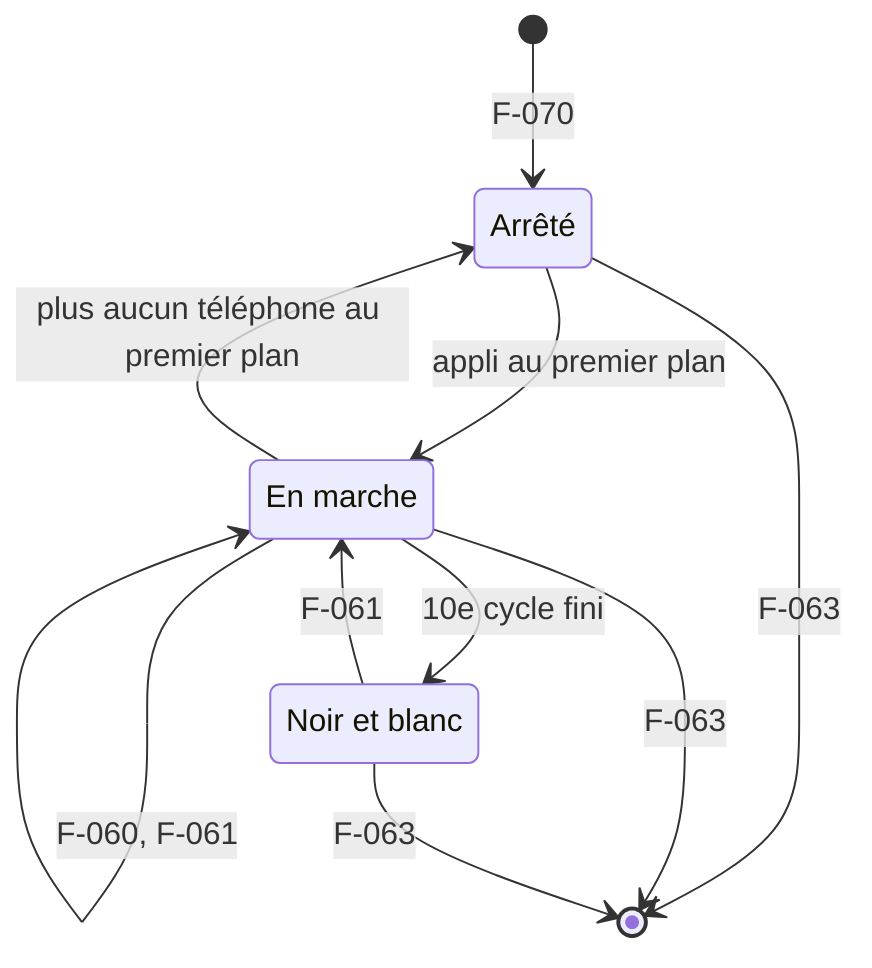
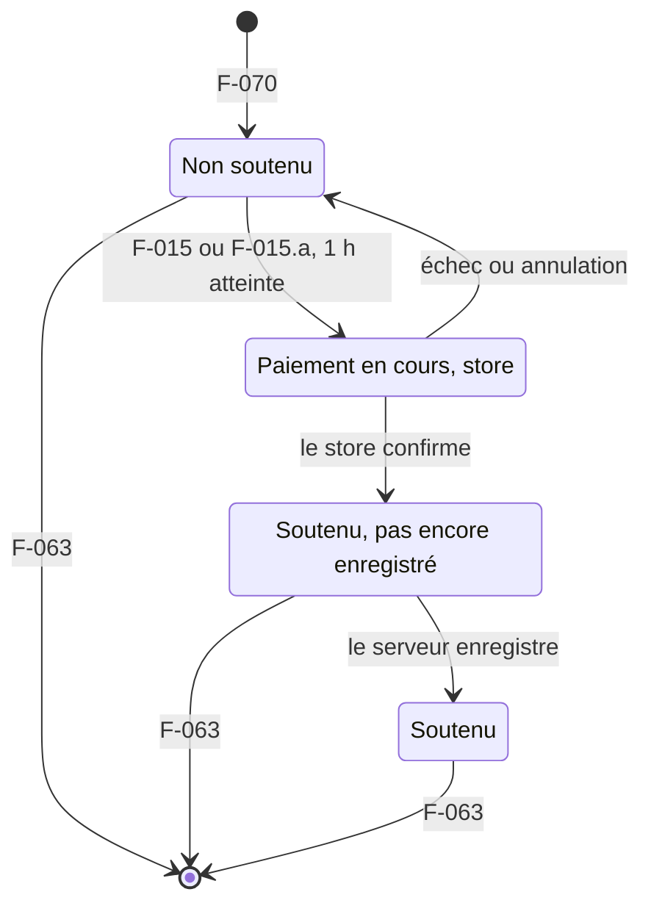

<!-- Source: https://claude.ai/artifact/V35ZLk13bPhs4byZvSoaXg, tab "Tab 1", rev 122, exported 2026-11-26 -->
# Conception système – Fake scrolling

Nov 24, 2026 · @Jp

Les flows de l'appli (prompt 5 de la méthode), un par section, écrits uniquement avec les IDs du [Registre canonique – Fake scrolling](https://claude.ai/artifact/A5qaJU9xAkPWfJ6JUNfWHV). Les choix qu'ils ont demandés sont dans les `decisions` du registre.

## FL-01 Se connecter

Une personne non connectée (R-01) arrive sur P-01 et en ressort connectée (R-02) sur P-03, par un compte tiers ou par un code reçu par e-mail. Mobile seulement. Décisions : D-024, D-052, D-053, D-054, D-069, D-114.

### Entrées

- Ouverture de l'appli sans session sur l'appareil → P-01. Avec une session ouverte, l'appli s'ouvre sur P-03 sans passer par ce flow (D-053).
- Lien de post ouvert sans connexion → P-01 ; le post attend la fin du flow (D-024, D-054).
- Déconnexion F-071 sur P-21, ou suppression du compte F-063 → P-01 (D-053) ; après la suppression, « Compte supprimé » reste 2 s avant P-01 (D-069).

### Séquence

| Étape | Page | Feature | Entités lues | Entités écrites |
| --- | --- | --- | --- | --- |
| 1. Accueil de la connexion | P-01 | F-002, F-004 | E-17 (thème de l'icône) | — |
| 2a. Compte tiers | P-01 → P-01.a | F-001 (Google) ou F-001.a (Apple) | E-02 (fournisseur), E-01 (compte existant ?) | E-02 (fournisseur, session) |
| 2b. Demande du code | P-01 → P-01.d | F-003 | — | E-02 (adresse e-mail, code à 6 chiffres, délai avant renvoi) |
| 3b. Saisie du code | P-02 | F-006, F-007 | E-02 (adresse, code), E-01 (compte existant ?) | E-02 (session) |
| 3b'. Renvoi du code | P-02 | F-008 | E-02 (délai avant renvoi) | E-02 (nouveau code) |
| 4. Inscription, si aucun compte | P-27 | F-070 | E-02 (fournisseur ou adresse) | E-01 (pseudo, identifiant), E-02 (session), E-14, E-15 et E-16 (valeurs de départ, D-114) |
| 5. Arrivée sur le fil | P-03.a → P-03 | F-009 | E-03 (posts ; d'abord le post du lien, D-054) | — |

Suite simple : P-01 → F-001 / F-001.a → (P-27 → F-070) → P-03, ou P-01 → F-003 → P-02 → F-007 → (P-27 → F-070) → P-03. Les entités suivent les `operations` des features : F-003 écrit E-02 ; F-006 la lit ; F-001, F-007, F-008, F-070 lisent et écrivent. À partir de P-03, le grisage F-024 s'applique ; P-01, P-02 et P-27 ne sont jamais grisées (D-009, D-019, D-052).

### Points de décision et erreurs

| Où | Cas | Suite |
| --- | --- | --- |
| P-01 | Compte tiers ou e-mail | F-001 / F-001.a, ou F-003 |
| P-01.a | Le fournisseur échoue | P-01.b : réessayer F-001 / F-001.a, ou passer à F-003 |
| P-01.a | Annulation sur l'écran du fournisseur | Retour à P-01, à confirmer avec cet écran (question ouverte de F-001) |
| P-01 | Adresse invalide | P-01.c : bouton désactivé, on reste sur P-01 |
| P-01.d | L'envoi du code échoue | P-01.e : « Réessayer » relance P-01.d |
| P-02 | Mauvaise adresse | F-005 : retour à P-01 |
| P-02 | Code faux | P-02.a : corriger les cases, puis F-007 |
| P-02 | Code expiré | P-02.b : F-008 « Renvoyer un code », puis P-02 |
| P-02 | Code pas reçu | F-008 après le décompte de 30 s |
| F-001, F-007 | Compte trouvé (lecture E-01) | P-03 |
| F-001, F-007 | Aucun compte | P-27, F-070 (D-052) |
| P-27 | Abandon | F-005 : retour à P-01, sans compte créé |
| P-27 | Identifiant pris, erreur d'enregistrement | Erreur : P-27.b, « Réessayer », saisies gardées (D-064) ; identifiant pris : question ouverte de F-070 |
| P-03.a | Le fil ne charge pas | P-03.b : « Réessayer » (F-009) |
| P-03 | Post du lien supprimé ou hors audience | Non défini (question ouverte de F-009) |

Fin du flow : P-03, en R-02, session ouverte (D-053).

### Manques du registre

Ajoutés le 24 novembre 2026 :

- P-27 Inscription et F-070 Créer son compte : aucun écran ne faisait choisir le pseudo et l'identifiant d'un nouveau compte (D-052). Dessinés depuis, avec P-27.a et P-27.b (D-063, D-064).
- F-071 Se déconnecter sur P-21, et la session dans E-02 : la seule sortie était la suppression du compte (D-053). Dessiné depuis, sans confirmation (D-065).
- La suite d'un lien de post après la connexion (D-054).

Restent ouverts, dans les `questions_ouvertes` des features :

- F-001 : l'écran d'autorisation du fournisseur et son annulation.
- F-007 : durée de validité du code et nombre d'essais faux avant blocage.
- F-070 : règles de l'identifiant (photo et description viennent plus tard, D-063 ; états dessinés, D-064).
- F-071 : réglé depuis, pas de confirmation (D-065).
- F-009 : post du lien devenu invisible.

## FL-02 Parcourir le fil et réagir à un post

Un utilisateur connecté (R-02) fait défiler le fil de P-03 et réagit à un post : like, commentaires sur P-05, enregistrement sur P-06, partage sur P-07. Chaque panneau se ferme sur P-03 (F-027). Mobile seulement. Décisions : D-030, D-043, D-049, D-050, D-051, D-055, D-056, D-057, D-058.

### Entrées

- Arrivée sur P-03, à la fin de FL-01 ou depuis le menu (F-025).
- Un résultat de recherche ouvert sur P-16 offre les mêmes réactions et les mêmes panneaux (D-049, D-050) ; le retour vers P-15 passe par F-010.a.

Hors de ce flow : le post Premium (F-015.a), les notifications reçues (F-022), le grisage (F-024), la création de post (F-026).

### Séquence

| Étape | Page | Feature | Entités lues | Entités écrites |
| --- | --- | --- | --- | --- |
| 1. Faire défiler | P-03.a → P-03 | F-009 | E-03 | — |
| 2. Regarder un post | P-03 | F-010, F-011, F-012, F-012.a, F-014, F-020, F-021 | E-03, E-04 ; E-17 pour F-012.a (carrousels de pause activés ?) | — |
| 3. Liker ou retirer le like | P-03 | F-016, F-016.a | E-03 | E-06 (like), E-03 (nombre de likes), E-08 (notification à l'auteur, D-055) ; le retrait supprime E-06 et E-08 |
| 4. Ouvrir les commentaires | P-03 → P-05.a → P-05 | F-017 | E-05, E-03 | — |
| 4'. Liker un commentaire | P-05 | F-016.b | E-05 | E-06 (cible : commentaire), E-05 (nombre de likes) ; pas de notification (D-055) |
| 4''. Publier un commentaire | P-05 | F-030 | — | E-05, E-03 (nombre de commentaires), E-08 (notification « commentaire » à l'auteur du post, D-056) |
| 5. Enregistrer | P-03 → P-06 | F-018 | E-07 (collections, celle du post) | E-07 (posts enregistrés), E-03 (nombre d'enregistrements) ; retirer = suppression (D-057) |
| 5'. Nouvelle collection | P-06 → P-06.a | F-031 | — | E-07 (« Collection N », avec le post) |
| 6. Partager | P-03 → P-07 | F-019 | E-03 | — |
| 6a. Envoyer à un ami | P-07 | F-019.a | E-10 (rangée de contacts) | E-11 (message avec le post partagé), E-10 (dernier message), E-03 (nombre de partages, D-058) |
| 6b. Copier le lien | P-07 | F-019.b | E-03 (lien) | E-03 (nombre de partages, D-058) |
| 6c. Partager ailleurs | P-07 | F-019.c | E-03 | E-03 (nombre de partages, D-058) |
| 7. Fermer le panneau | P-05, P-06, P-07 → P-03 | F-027 | — | — |

Suite simple : P-03 → F-009 → F-016 / F-016.a, ou P-03 → F-017 → P-05 → F-030 / F-016.b → F-027 → P-03, ou P-03 → F-018 → P-06 → P-03, ou P-03 → F-019 → P-07 → P-03. Les entités suivent les `operations` des features : F-009, F-010, F-011, F-012, F-014, F-017, F-020, F-021 lisent ; F-030, F-031 écrivent ; F-016 et F-018 lisent, écrivent et suppriment ; F-019 lit et écrit.

### Points de décision et erreurs

| Où | Cas | Suite |
| --- | --- | --- |
| P-03.a | Les posts suivants ne chargent pas | P-03.b : « Réessayer » (F-009, D-032) |
| P-03 | Like non enregistré | P-03.e : le cœur redevient vide, message 2 s, on reste sur P-03 |
| P-03 | Double tap sur un post déjà liké | F-016.a ne retire jamais le like |
| P-05.a | Les commentaires ne chargent pas | P-05.d : « Réessayer » (F-017) |
| P-05 | Aucun commentaire | P-05.b : « Écris le premier. », F-030 |
| P-05 | Champ vide | Bouton « Publier » gris (F-030) |
| P-05 | Commentaire non publié | P-05.c : « Non publié. » avec « Réessayer » (D-030) |
| P-05 | Like de commentaire non enregistré | Petit cœur redevenu gris, message 2 s en bas du panneau (D-043) |
| P-03 | Signet vide ou plein | Les deux ouvrent P-06 ; plein : la collection du post est encadrée (D-057) |
| P-06 | Tap sur la collection encadrée | Post retiré, « Retiré de … », retour à P-03 (D-057) |
| P-06 | Tap sur une autre collection | Post déplacé, « Enregistré dans … », retour à P-03 (D-057) |
| P-06.a | La collection n'est pas créée | P-06.b : « Réessayer » (F-031) |
| P-03 | Enregistrement échoué | P-03.f : signet redevenu vide, message 2 s |
| P-07 | Rangée d'amis en chargement ou en échec | Anneau, puis message sur place avec « Réessayer » (D-043) |
| P-07 | Envoi à un ami échoué | P-07.a : ami cerclé de rouge, « Non envoyé à … », « Réessayer », le panneau reste ouvert |
| P-07 | Partage réussi | Message 2 s sur P-03 ou P-16 : « Envoyé à … », « Lien copié. » ou « Partagé. » (D-051) |
| P-05, P-06, P-07 | Croix, « OK » ou tap sur le fond | F-027 : retour à P-03 |

Fin du flow : retour au fil, P-03 (ou P-16), avec les compteurs du post à jour.

### Manques du registre

Réglés le 24 novembre 2026 :

- Aucune feature n'écrivait les notifications de like : F-016 écrit E-08 (D-055).
- Un commentaire notifie l'auteur du post : E-08 a un type « commentaire », F-030 l'écrit, P-04 redessiné depuis (F-022, D-056).
- Le signet plein et le nombre de collections par post (F-018, D-057).
- Les partages qui comptent (F-019, D-058).

Restent ouverts, dans les `questions_ouvertes` des features :

- F-016, F-017, F-018, F-019, F-020, F-030 : accès supposé à tout post qu'on peut voir, selon son audience (F-050).
- F-019 : rangée limitée aux amis ; partage d'un post « Amis proches » ; aspect du post reçu sur P-09.
- F-031 : saisie du nom de la collection.
- F-011 : pause et déplacement dans la vidéo.

## FL-03 Publier un post

Un utilisateur connecté (R-02) choisit des photos sur P-12, écrit la légende et règle ses options sur P-13, puis publie dans le fil (P-03) ou en story (P-08). Avant la publication, seule la graine de chaque photo part au serveur, pour préparer l'art généré ; le reste n'est enregistré qu'à la publication (D-045, D-120). Mobile seulement. Décisions : D-001, D-012, D-031, D-033, D-034, D-035, D-045, D-047, D-059, D-060, D-061, D-062, D-068, D-120, D-121, D-122, D-123.

### Entrées

- Bouton + du menu (F-026) sur P-03, P-08, P-14, P-15, P-16 ou P-17 → P-12, destination « Fil d'actualité ».
- « Créer un post » de l'état vide P-17.a (F-026, D-035) → P-12.
- Rond « Ta story » de P-08 (F-026.a, D-001) → P-12, destination « Story » présélectionnée (F-068).

Hors de ce flow : la palette du post publié (question ouverte de F-051), sa légende en charabia (D-118) et ses photos en art généré (D-086, D-119) ; un post n’expire jamais (D-097) ; le grisage F-024, qui s'applique à toutes ces pages.

### Séquence

| Étape | Page | Feature | Entités lues | Entités écrites |
| --- | --- | --- | --- | --- |
| 1. Choisir les photos | P-12 | F-044, F-045 | E-04 (galerie, album) | E-04 (graine, envoyée au serveur dès le choix, D-120 ; sans réseau, en attente dans FL-12, D-122), E-03 ou E-12 (brouillon : photos choisies, rang dans le carrousel, D-068) |
| 1'. Prendre une photo | P-12 ou P-12.a | F-046, F-046.a | — | E-04 (graine, envoyée au serveur, D-120 ; sans réseau, en attente dans FL-12, D-122), E-03 ou E-12 (brouillon : la photo prise devient celle du post ou de la story, D-047, D-068) |
| 2. Passer à la légende | P-12 → P-13 | F-044 (« Suivant ») | — | — |
| 3. Écrire la légende | P-13 | F-047 | — | E-03 ou E-12 (brouillon : légende, D-068) |
| 4. Choisir où publier | P-13 | F-068 | — | E-03 ou E-12 (destination) |
| 5. Identifier des personnes | P-13 → P-24 | F-048 | E-09 (amis) | E-03 ou E-12 (personnes identifiées, D-059) |
| 6. Ajouter un lieu | P-13 → P-25 | F-049 | — (aucune entité pour les lieux) | E-03 ou E-12 (lieu, D-059) ; « Retirer le lieu » le supprime |
| 7. Choisir l'audience | P-13 → P-26 | F-050 | — | E-03 ou E-12 (audience, D-059) |
| 7'. Modifier la liste d'amis proches | P-26 → P-28 | F-072 | E-09 (amis) | E-09 (ami proche, D-060) |
| 8. Fermer un panneau | P-24, P-25, P-26 → P-13 ; P-28 → P-26 | F-027 | — | — |
| 9. Publier | P-13 → P-13.a → P-13.c | F-051 | E-03 ou E-12 (brouillon), E-04 | E-03 et E-04 (post), ou E-12 (story) ; E-08 (une notification « identification » par personne identifiée, D-061) |
| 10. Arrivée | P-03.d ou P-08.b | F-051 | E-03 ou E-12 | — |

Suite simple : P-03 → F-026 → P-12 → F-044 → P-13 → F-047 → (P-24 F-048, P-25 F-049, P-26 F-050 → P-28 F-072) → F-051 → P-03, ou P-08 → F-026.a → P-12 → … → F-068 « Story » → F-051 → P-08. Les entités suivent les `operations` des features : F-045 lit ; F-046, F-047, F-050, F-068 écrivent ; F-044, F-048, F-051, F-072 lisent et écrivent ; F-049 lit, écrit et supprime. Avant F-051, ces écritures ne touchent que le brouillon sur l'appareil, sauf la graine de chaque photo, envoyée dès le choix (D-120), ou par FL-12 dès que le réseau revient (D-122).

### Points de décision et erreurs

| Où | Cas | Suite |
| --- | --- | --- |
| P-12 | Galerie vide | P-12.a : « Ouvrir l'appareil photo » (F-046.a, D-033, D-047) |
| P-12 | Accès aux photos refusé | P-12.b : « Ouvrir les réglages » du téléphone (F-044, D-034) |
| P-12 | Prise de vue refusée ou annulée | Non dessinée (questions ouvertes de F-046) |
| P-12 | Sélection simple ou multiple | Une photo, ou jusqu'à 10 numérotées (F-044) |
| P-12 | « Suivant » | Toujours actif : une photo au moins est choisie |
| P-12 | Croix « Fermer » (F-005.a) | Brouillon abandonné sans confirmation (D-045), ses graines effacées du serveur, par FL-12 sans réseau, et celles qui attendaient encore jamais envoyées (D-121, D-122), retour à la page d'origine (D-062) ; ouverte depuis la Recherche (P-14 à P-16), retour sur P-14 (D-090) |
| P-12 | Photo retirée de la sélection (F-044) | Sa graine effacée du serveur, par FL-12 sans réseau ; jamais envoyée si elle attendait encore (D-121, D-122) |
| P-12, P-13 | Brouillon perdu sans « Fermer » (appli fermée de force, téléphone éteint) | Ses graines en attente ne partent jamais (D-122) ; celles déjà envoyées sont effacées par FL-14, 24 h après leur arrivée (D-123) |
| P-13 | Flèche retour (F-005) | P-12, photos choisies gardées |
| P-13 | Fil d'actualité ou Story (F-068) | Bouton « Partager dans le fil » ou « Partager en story » |
| P-24, P-25 | Liste en chargement ou en échec | Anneau, puis message sur place avec « Réessayer » (D-043) |
| P-24, P-25 | Aucun résultat | « Aucun ami trouvé. » ou « Aucun lieu trouvé. » |
| P-25 | Un lieu est déjà choisi | « Retirer le lieu » (F-049) |
| P-26 | « Amis proches » avec une liste vide | Non défini (question ouverte de F-072) |
| P-28 | Liste en chargement ou en échec | Anneau, puis message sur place avec « Réessayer » (F-072) |
| P-13.a | Graines encore en attente, ou déjà effacées par FL-14 | Elles partent avec la publication (D-120, D-122, D-123) |
| P-13.a | La publication échoue | P-13.b : pas de fondu, photos et légende gardées (D-120), « Réessayer » relance F-051 (D-027) |
| P-13.a | Publié dans le fil | Fondu vers l'art généré et le charabia (P-13.c, D-120), puis P-03 avec le toast « Post publié. » (P-03.d, D-031) |
| P-13.a | Publié en story | Fondu vers l'art généré et le charabia (P-13.c, D-120), puis P-08 avec le toast « Story publiée. » (P-08.b, D-031) |

Fin du flow : P-03 avec le post publié, ou P-08 avec la story publiée ; les personnes identifiées en sont notifiées sur P-04 (D-061).

### Manques du registre

Réglés le 24 novembre 2026 :

- Une story n'avait ni audience, ni personnes identifiées, ni lieu : E-12 les prend, F-048, F-049 et F-050 l'écrivent (D-059).
- Aucune liste d'« Amis proches » : E-09 prend « ami proche », F-072 la règle sur le nouveau panneau P-28, ouvert depuis P-26 (D-060). P-26 et P-28 dessinés depuis.
- Une identification ne notifiait personne : E-08 a un type « identification », F-051 l'écrit (D-061). P-04 redessiné depuis (F-022).
- La croix de P-12 ramenait toujours à l'Accueil : elle ramène à la page d'origine (D-062). Design mis à jour depuis (F-005).

Réglés le 25 novembre 2026 : sans réseau, les graines et leurs effacements attendent dans FL-12 (D-122) ; les graines d'un brouillon perdu sont effacées 24 h après leur arrivée par FL-14 (D-123), et la question ouverte de F-044 est close.

Restent ouverts, dans les `questions_ouvertes` des features :

- F-044, F-045 : vraie galerie, autorisation d'accès, liste des albums.
- F-046 : écran de prise de vue, autorisation de l'appareil photo.
- F-047 : limite de longueur de la légende.
- F-048 : liste de démo ; seuls des amis peuvent être identifiés.
- F-049 : vraie recherche de lieux, et donc la source des lieux.
- F-050 : règle de l'audience (qui voit le post et agit dessus).
- F-051 : palette du post (il n’expire pas, D-097).
- F-072 : liste vide ; effet d'un changement sur les posts déjà publiés.

## FL-04 Ajouter un ami

Un utilisateur connecté (R-02) cherche un compte par son @ sur P-11 et lui envoie une demande ; l'autre utilisateur (R-02) l'accepte ou la refuse sur P-04. Une fois acceptée, les deux ont une conversation vide dans P-08. Mobile seulement. Décisions : D-006, D-035, D-042, D-044, D-048, D-070, D-071, D-072, D-073, D-106.

### Entrées

- Bouton + de P-08 (F-034) → P-11.
- « Ajouter un ami » de l'état vide P-08.a (F-034, D-035) → P-11.
- Pour le destinataire : la cloche de P-03 (F-022) → P-04, section « Invitations » (D-044).

Hors de ce flow : écrire au nouvel ami (F-041, flow des messages) ; les listes d'amis de F-019.a, F-048 et F-072 ; le grisage F-024, qui s'applique à P-04, P-08 et P-11.

### Séquence

| Étape | Page | Feature | Entités lues | Entités écrites |
| --- | --- | --- | --- | --- |
| 1. Ouvrir l'ajout d'un ami | P-08 ou P-08.a → P-11 | F-034 (bouton +, « Ajouter un ami ») | — | — |
| 2. Chercher un compte | P-11 → P-11.a → P-11 | F-043 | E-01 (pseudo, identifiant, photo), E-09 (statut de chaque compte) | — |
| 3. Envoyer la demande | P-11 → P-11.c → P-11 | F-034 | E-09 | E-09 (« demandé » chez l'expéditeur, « en attente » chez le destinataire), E-08 (notification « invitation » au destinataire, D-070) |
| 3'. Ajouter un compte qui nous a déjà invité | P-11 → P-11.c → P-11 | F-034 | E-09 (« en attente ») | E-09 (« ami »), E-10 (conversation vide), E-08 (invitation supprimée) (D-073) |
| 4. Voir l'invitation (destinataire) | P-03 → P-04.b → P-04 | F-022 | E-08 (pastille), E-09 (invitations en attente) | E-08 (toutes vues, la pastille disparaît, D-106) |
| 5a. Accepter | P-04 → P-04.d → P-04 | F-028 | — | E-09 (« ami » des deux côtés), E-10 (conversation vide, D-071), E-08 (invitation supprimée, D-070) |
| 5b. Refuser | P-04 | F-028.a | — | E-09 (demande supprimée, D-048), E-08 (invitation supprimée, D-070) |
| 6. Fermer le panneau | P-04 → P-03 | F-027.a | — | — |

Suite simple : P-08 → F-034 → P-11 → F-043 → F-034, puis chez le destinataire P-03 → F-022 → P-04 → F-028 (ou F-028.a) → F-027.a → P-03. Les entités suivent les `operations` des features : F-043 lit ; F-022 lit et marque les notifications vues (D-106) ; F-028 écrit et supprime ; F-034 lit, écrit et supprime.

### Points de décision et erreurs

| Où | Cas | Suite |
| --- | --- | --- |
| P-11 | Champ vide | Rien n'est affiché (F-043) |
| P-11.a | La recherche échoue | P-11.b : « Réessayer » (F-043) |
| P-11 | Aucun compte | « Aucun compte trouvé. » |
| P-11 | Compte déjà ami | « Ami » gris et désactivé |
| P-11 | Demande déjà envoyée | « Demandé » gris et désactivé ; pas d'annulation (question ouverte de F-034) |
| P-11 | Le compte nous a déjà invité | « Ajouter » accepte son invitation et devient « Ami » (D-073) |
| P-11.c | L'envoi échoue | P-11.d : « La demande n’a pas été envoyée. » avec « Réessayer » ; le bouton redevient « Ajouter » (D-042) |
| P-04.b | Les notifications ne chargent pas | P-04.c : « Réessayer » (F-022) |
| P-04 | Aucune invitation | Section « Invitations » masquée ; P-04.a si rien d'autre |
| P-04.d | La réponse échoue | P-04.e : « Ta réponse n’a pas été envoyée. » avec « Réessayer » (D-042) |
| P-04 | Refus | La ligne disparaît ; l'expéditeur revoit « Ajouter » et peut redemander (D-048) |
| F-028 | Acceptation | Pas de notification à l'expéditeur (D-072) : il voit la conversation dans P-08 et « Ami » dans P-11 |

Fin du flow : les deux comptes sont amis (E-09 « ami »), avec une conversation vide dans P-08 qui s'ouvre sur P-09.b.

### Manques du registre

Réglés le 24 novembre 2026 :

- Aucune feature n'écrivait la notification « invitation » : F-034 l'écrit, F-028 la supprime (D-070).
- Aucune conversation ne s'ouvrait avec un nouvel ami : l'acceptation en crée une vide (D-071).
- L'acceptation ne notifie pas l'expéditeur (D-072).
- Une demande vers un compte qui nous a déjà invité accepte son invitation (D-073).

Restent ouverts, dans les `questions_ouvertes` des features :

- F-034 : annuler une demande envoyée ; retirer un ami ou bloquer un compte.
- F-043 : vrai annuaire ; comptes privés ou bloqués ; son propre compte dans les résultats.
- F-022, F-028 : accès supposé aux seules invitations reçues et en attente.
- F-037 : peut-on écrire à un non-ami ? Réglé depuis par FL-07 : amis seulement (D-082).

## FL-05 Griser l'app par cycles

Tâche de fond, sans geste de l'utilisateur : tant qu'un utilisateur connecté (R-02) a l'appli ouverte, le minuteur de couleur de son compte (E-14) avance, et chaque cycle terminé retire 10 % de couleur à toutes les pages de F-024. Après 10 cycles, l'appli reste en noir et blanc jusqu'à « Réinitialiser » (F-061). Mobile seulement. Décisions : D-009, D-019, D-052, D-074, D-075, D-076, D-077, D-105, D-117.

### Entrées

- Fin de FL-01 : la connexion ouvre P-03 et le minuteur du compte reprend où il en était (D-074).
- Ouverture de l'appli avec une session ouverte (D-053), ou retour de l'appli au premier plan.
- Sur P-17 : changer la durée du cycle (F-060) ou réinitialiser (F-061).

Hors de ce flow : P-01, P-02 et P-27, jamais grisées (D-009, D-019, D-052) ; le temps d'utilisation (E-15) et le post Premium (F-015, F-065), dans FL-09.

### Séquence

| Étape | Déclencheur | Page | Feature | Entités lues | Entités écrites |
| --- | --- | --- | --- | --- | --- |
| 1. Reprendre le minuteur | Appli ouverte ou revenue au premier plan, connecté | Pages de F-024 | F-024 | E-14 (durée, cycles écoulés, temps passé dans le cycle) | — |
| 2. Avancer | Chaque seconde, appli au premier plan | Pages de F-024 | F-024 | E-14 | E-14 (temps passé dans le cycle en cours, D-075) |
| 3. Finir un cycle | Le temps passé atteint la durée | Pages de F-024 | F-024 | E-14 | E-14 (cycles écoulés + 1, 10 % de gris en plus, temps remis à 0) |
| 4. Noir et blanc | 10 cycles écoulés | Pages de F-024 | F-024 | E-14 | — (le minuteur s'arrête) |
| 5. Suivre le minuteur | L'utilisateur ouvre P-17 | P-17 | F-059 | E-14 (cycle sur 10, % de gris, temps restant) | — |
| 6. Changer la durée | Flèche haut ou bas | P-17 | F-060 | — | E-14 (durée ; cycles gardés, D-076) |
| 7. Réinitialiser | Bouton « Réinitialiser » | P-17 | F-061 | — | E-14 (cycle 1, 0 % de gris) |
| 8. S'arrêter | Appli fermée ou en arrière-plan, déconnexion (F-071) | — | F-024 | — | E-14 (temps passé gardé sur le serveur, D-074) |

Suite simple : ouverture → F-024 (1 → 2 → 3, dix fois) → noir et blanc, et sur P-17 : F-059, F-060, F-061 → retour aux couleurs. Les entités suivent les `operations` des features : F-059 lit ; F-060 et F-061 écrivent ; F-024 lit et écrit (D-075).

### Points de décision et erreurs

| Où | Cas | Suite |
| --- | --- | --- |
| Pages de F-024 | Appli au premier plan | Le minuteur avance (D-075), même sans réseau : le téléphone grise de lui-même et ses secondes repartent par FL-12 (D-117) |
| Toutes | Appli fermée ou en arrière-plan | Le minuteur s'arrête, rien ne grise (D-075) |
| P-01, P-02, P-27 | Pas encore connecté, ou inscription | Jamais grisées (D-009, D-019, D-052) |
| FL-01 | Reconnexion, ou autre téléphone | Le minuteur du compte reprend au même gris (D-074) |
| Pages de F-024 | 10 cycles écoulés | Noir et blanc sans message ; sur P-17, F-059 dit « Noir et blanc. Réinitialise pour retrouver les couleurs. » |
| P-17 | Flèche à 1 ou 30 min | Flèche grisée (F-060) |
| P-17 | Nouvelle durée en cours de cycle | Cycles gardés, la durée vaut pour la suite (D-076) |
| P-17 | Le serveur n'enregistre pas la durée ou la réinitialisation | Appliquée sur le téléphone, renvoyée sans message (D-077, FL-12) |
| P-17 | Réinitialiser | Cycle 1, couleurs revenues sur toutes les pages (F-061) |

Fin du flow : aucune ; le minuteur s'arrête quand l'appli se ferme et reprend à l'ouverture.

### Manques du registre

Réglés le 24 novembre 2026 :

- Le minuteur appartient au compte, pas au téléphone (D-074) : les questions ouvertes de F-059, F-060 et F-061 sont closes.
- Seul le temps passé appli ouverte fait griser (D-075) : E-14 garde ce temps au lieu du début du cycle, et F-024 l'écrit.
- Changer la durée garde les cycles écoulés (D-076).
- Un réglage non enregistré est renvoyé sans message (D-077).

Restent ouverts, dans les `questions_ouvertes` des features :

- F-024 : deux téléphones ouverts en même temps sur le même compte ; réglé depuis par D-105 (le temps ne compte qu'une fois).
- F-065 : temps d'utilisation (E-15) compté par compte ou par appareil ; réglé depuis par D-093 (FL-09).

## FL-06 Voir une story

Un utilisateur connecté (R-02) touche le cercle d'un ami dans P-08 ou P-09 et regarde ses stories en cours dans P-10, image par image ; à la fermeture, elles comptent comme vues pour lui seul. Mobile seulement. Décisions : D-059, D-060, D-078, D-079, D-080, D-081.

### Entrées

- P-08, rangée de stories : rond cerclé d'un ami (F-036) → P-10.
- P-08, liste des discussions : photo cerclée d'une discussion (F-036) → P-10.
- P-09 : photo cerclée du contact en haut (F-036) → P-10.

Hors de ce flow : publier une story (FL-03, F-026.a, F-051) ; voir sa propre story (question ouverte de F-036) ; ouvrir une discussion (F-037) ; le grisage F-024, qui s'applique aussi à P-10 (FL-05).

### Séquence

| Étape | Page | Feature | Entités lues | Entités écrites |
| --- | --- | --- | --- | --- |
| 1. Voir qui a une story | P-08, P-09 | F-036 (cercles vert ou gris) | E-12 (auteur, fin, audience, vue par), E-09 (ami, ami proche) | — |
| 2. Ouvrir les stories d'un ami | P-08 ou P-09 → P-10.a → P-10 | F-036 | E-12 (images, texte, ancienneté, auteur) | — |
| 3. Regarder | P-10 | F-036 (5 s par image, barres de progression) | E-12 | — |
| 4. Image suivante ou précédente | P-10 | F-036 (tap sur les deux tiers droits ou le tiers gauche) | E-12 | — |
| 5. Story suivante du même ami | P-10 | F-036 (D-081) | E-12 | — |
| 6. Fermer | P-10 → P-08 ou P-09 | F-036 (croix, ou fin après la dernière image) | — | E-12 (vue par : le compte qui regarde, D-078) |

Suite simple : P-08 (ou P-09) → F-036 → P-10.a → P-10 → F-036 (images, puis stories suivantes) → fermeture → P-08 (ou P-09), cercle gris. Les entités suivent les `operations` de F-036 : il lit E-12 et E-09, et écrit « vue par » dans E-12.

### Points de décision et erreurs

| Où | Cas | Suite |
| --- | --- | --- |
| P-08, P-09 | L'ami n'a aucune story en cours | Pas de rond dans la rangée ; photo sans cercle dans la liste et en haut de P-09 |
| P-08, P-09 | Story « Amis proches » et je ne suis pas dans la liste de l'auteur | Elle ne m'est pas montrée (D-080) |
| P-08, P-09 | Toutes les stories de l'ami sont vues | Cercle gris ; elles se rouvrent quand même |
| P-10.a | Le chargement échoue | P-10.b : « La story n’a pas pu être chargée. » avec « Réessayer » ; fermer sans image montrée laisse la story non vue (D-078) |
| P-10 | La story a atteint ses 24 h pendant qu'on est sur P-08 | P-10.b ; son cercle disparaît au chargement suivant (D-079) |
| P-10 | Tap à gauche sur la première image | Reste sur la première image |
| P-10 | Fin d'une story, l'ami en a une autre en cours | La suivante commence, ses barres repartent (D-081) |
| P-10 | Fin de la dernière image de la dernière story | Le lecteur se ferme et revient à la page d'où il a été ouvert |
| P-10 | Le serveur n'enregistre pas « vue » | Cercle gris sur le téléphone, renvoyé sans message (D-078, FL-12) |

Fin du flow : retour sur P-08 ou P-09 ; le cercle de l'ami est gris s'il n'a plus de story non vue.

### Manques du registre

Réglés le 24 novembre 2026 :

- « Vue » était un seul champ de la story : E-12 garde les comptes qui l'ont vue, écrits à la fermeture (D-078).
- Aucune story ne finissait : elle dure 24 h après la publication (D-079).
- Accès : amis seulement, « Amis proches » filtre (D-080) ; F-036 lit E-09.
- Plusieurs stories d'un même ami s'enchaînent sous un seul cercle (D-081).

Restent ouverts, dans les `questions_ouvertes` des features :

- F-036 : voir sa propre story et qui l'a vue ; ordre des ronds de la rangée de P-08.
- F-072 : un changement de la liste d'amis proches vaut-il pour les stories déjà publiées ?

## FL-07 Discuter avec un ami

Un utilisateur connecté (R-02) ouvre Messages, choisit la conversation d'un ami dans P-08 et échange avec lui dans P-09 : messages en charabia, photos en art généré, réponses citées. Les messages de l'ami arrivent en direct. Mobile seulement. Décisions : D-027, D-030, D-042, D-044, D-071, D-082, D-083, D-084, D-085, D-086.

### Entrées

- Icône bulle du menu du bas (F-025) → P-08.
- Fin de FL-04 : la conversation vide avec le nouvel ami apparaît dans P-08 (D-071).
- Un post envoyé à un ami (F-019.a, FL-02) arrive en message dans sa conversation (D-044).

Hors de ce flow : ajouter un ami (FL-04, F-034) ; voir une story depuis P-08 ou P-09 (FL-06, F-036) ; publier une story depuis « Ta story » (FL-03) ; le grisage F-024, qui s'applique à P-08 et P-09 (FL-05).

### Séquence

| Étape | Page | Feature | Entités lues | Entités écrites |
| --- | --- | --- | --- | --- |
| 1. Ouvrir Messages | P-03 → P-08.c → P-08 | F-025, F-037 | E-10 (contact, dernier message, heure, lu / non lu) | — |
| 2. Chercher une discussion | P-08 | F-033 | E-10 (prénom, @) | — |
| 3. Ouvrir une conversation | P-08 → P-09.a → P-09 | F-037, F-038 | E-10, E-11 | E-10 (lu, D-085) |
| 4. Lire et recevoir | P-09 | F-038 | E-11 (messages en direct, saisie de l'ami, D-084) | E-10 (reste lu, D-085) |
| 5. Citer un message | P-09 | F-040 | — | E-11 (message cité, écrit avec l'envoi) |
| 6. Envoyer un message | P-09 | F-041 | — | E-11 (charabia, D-083), E-10 (dernier message, heure, non lu chez l'ami, D-085) |
| 7. Envoyer une photo | P-09 | F-042 | — | E-11 (photo), E-04 (graine et algorithme, D-086), E-10 (« Photo », heure, non lu chez l'ami, D-085) |
| 8. Revenir aux discussions | P-09 → P-08 | F-005 | — | — |

Suite simple : P-03 → F-025 → P-08 → F-037 → P-09 → F-040 (au besoin) → F-041 ou F-042 → F-005 → P-08. Les entités suivent les `operations` des features : F-033 et F-039 lisent ; F-040, F-041 et F-042 écrivent ; F-037 et F-038 lisent et écrivent (lu, D-085).

### Points de décision et erreurs

| Où | Cas | Suite |
| --- | --- | --- |
| P-08.c | Les discussions ne chargent pas | P-08.d : « Les discussions n’ont pas pu être chargées. » avec « Réessayer » |
| P-08 | Aucune discussion | P-08.a : « Ajouter un ami » ouvre P-11 (FL-04, D-035) |
| P-08 | La recherche ne trouve rien | Liste vide sans message (F-033) |
| P-08 | Écrire à un non-ami | Impossible : une conversation n'existe qu'entre amis (D-082) |
| P-08 | Message reçu hors de sa conversation | La discussion passe en gras avec le point bleu ; ni notification ni pastille (D-084) |
| P-09.a | Les messages ne chargent pas | P-09.d : « Les messages n’ont pas pu être chargés. » avec « Réessayer » |
| P-09 | Conversation vide (nouvel ami) | P-09.b : « Aucun message » · « Écris le premier message à … » |
| P-09 | L'ami écrit | Bulle grise à trois points (F-038, D-084) |
| P-09 | Message reçu, P-09 ouverte | Il s'ajoute en bas ; la conversation reste lue (D-085) |
| P-09 | Champ vide | L'icône image tient la place d'« Envoyer » (F-042) |
| P-09 | Croix du bandeau « Réponse à … » | La citation est annulée (F-040) |
| P-09.c | L'envoi d'un message échoue | Le message reste, « Non envoyé. » avec « Réessayer » seulement (D-027, D-030) |
| P-09.e | L'envoi d'une photo échoue | Photo cerclée de rouge, « Non envoyée. » avec « Réessayer » (D-042) |
| P-09 | Icône téléphone | Sans effet (question ouverte de F-039) |

Fin du flow : retour sur P-08 ; la conversation montre le dernier message et l'heure, et passe en non lu chez l'ami.

### Manques du registre

Réglés le 24 novembre 2026 :

- On ne savait pas si l'on pouvait écrire à un non-ami : amis seulement (D-082) ; les questions d'accès de F-037 à F-042 sont closes.
- Rien ne disait ce que contient un message : seul le charabia quitte le téléphone (D-083).
- La réception n'était que simulée : messages et saisie de l'ami en direct, sans notification (D-084).
- Aucune feature ne mettait la conversation à jour à l'envoi : F-041 et F-042 écrivent E-10, et « lu / non lu » est gardé pour chacun des deux amis (D-085).
- Dans toute l'app, photos et vidéos deviennent un art généré à partir d'une graine, seule envoyée ; le flou du design en tient lieu (D-086).

Restent ouverts, dans les `questions_ouvertes` des features :

- F-038 : jusqu'où remonte une conversation, et chargement des anciens messages.
- F-039 : appel à concevoir ou à retirer.
- F-042 : choix de la photo ; briques de l'art généré au départ, et vidéos (D-086, D-119).
- F-019 : aspect du post reçu dans la conversation, non dessiné sur P-09.
- F-034 : retirer un ami ou bloquer un compte, et donc le sort de la conversation.

## FL-08 Rechercher

Un utilisateur connecté (R-02) ouvre la Recherche, tape un mot ou touche une suggestion ou une tendance sur P-14, parcourt la grille de P-15, puis ouvre un résultat sur P-16, où il réagit comme dans le fil. Le texte tapé ne quitte jamais le téléphone : seule sa palette est envoyée. Mobile seulement. Décisions : D-046, D-049, D-050, D-051, D-062, D-087, D-088, D-089, D-090.

### Entrées

- Icône loupe du menu du bas (F-025), depuis toute page qui l'a → P-14, champ vide.
- Fermer une création de post ouverte depuis P-14, P-15 ou P-16 (F-005.a) → P-14 (D-090).

Hors de ce flow : les réactions sur P-16 et leurs panneaux P-05 à P-07 (FL-02, D-049, D-050) ; publier un post avec le bouton + (FL-03) ; chercher un compte (F-043, FL-04) ou une discussion (F-033, FL-07) ; le grisage F-024, qui s'applique à P-14, P-15 et P-16 (FL-05).

### Séquence

| Étape | Page | Feature | Entités lues | Entités écrites |
| --- | --- | --- | --- | --- |
| 1. Ouvrir la Recherche | P-03 (ou une autre page) → P-14.a → P-14 | F-025, F-053 | E-13 (8 suggestions tirées au hasard, 6 tendances, sur le téléphone, D-089), E-03 (nombre de posts visibles par palette, D-089) | — |
| 2. Taper une recherche | P-14 → P-15.a → P-15 | F-052 | E-13 (texte saisi → palette, sur le téléphone, D-087) ; E-03, E-09 (jusqu'à 18 posts visibles de la palette, D-088) | — |
| 2'. Lancer une suggestion ou une tendance | P-14 → P-15.a → P-15 | F-053, F-053.a, puis F-052 | E-13 (champ rempli), E-03, E-09 | — |
| 3. Modifier la recherche | P-15 | F-052 | E-13 (nouvelle palette à chaque frappe), E-03, E-09 | — |
| 4. Revenir aux suggestions | P-15 → P-14 | F-052 (champ vidé) | E-13 | — |
| 5. Ouvrir un résultat | P-15 → P-16 | F-054, F-010.a | E-03, E-04 | — |
| 6. Passer d'un résultat à l'autre | P-16 | F-009.a, F-010.a, F-020, F-021 | E-03, E-04 | — |
| 7. Réagir | P-16 → P-05, P-06, P-07 → P-16 | F-016, F-016.a, F-017, F-018, F-019, F-027 | Comme FL-02 | Comme FL-02 (E-06, E-03, E-08, E-05, E-07, E-11, E-10) |
| 8. Revenir aux résultats | P-16 → P-15 | F-010.a | — | — |

Suite simple : P-14 → F-052 (ou F-053) → P-15 → F-054 → P-16 → F-009.a → F-010.a → P-15. Les entités suivent les `operations` des features : F-052, F-053 et F-054 lisent seulement. E-13 vit sur le téléphone : rien de la recherche n'est écrit sur le serveur (D-087, D-089).

### Points de décision et erreurs

| Où | Cas | Suite |
| --- | --- | --- |
| P-14.a | Les suggestions ne chargent pas | P-14.b : « Les suggestions n’ont pas pu être chargées. » avec « Réessayer » ; le champ reste utilisable (F-053) |
| P-15 | Chaque frappe | La palette est recalculée sur le téléphone et la grille change (F-052, D-087) |
| P-15 | Champ vidé | Retour à P-14 |
| P-15.a | La recherche n'aboutit pas | P-15.c : « La recherche n’a pas abouti. » avec « Réessayer » |
| P-15.a | Aucun post visible dans la palette | P-15.b : « Aucun résultat » · « Aucun post ne correspond à « … ». Essaie un autre mot. » (D-087) |
| P-15 | Post hors de son audience pour l'utilisateur | Jamais dans les résultats ni dans les tendances (D-088, D-089) |
| P-16 | Premier ou dernier résultat | Résistance, pas de posts suivants à charger (F-009.a, D-049) |
| P-16 | Like ou enregistrement échoué | Comme P-03.e et P-03.f (FL-02, D-046) |
| P-16 | Partage réussi | Message 2 s sur P-16 : « Envoyé à … », « Lien copié. » ou « Partagé. » (D-051) |
| P-16 | Flèche retour ou Échap | P-15, même recherche (F-010.a) |
| P-12 | Création ouverte depuis la Recherche, puis fermée | P-14, champ vide (D-090) |

Fin du flow : retour sur P-15 avec la même recherche, ou sur P-14 champ vide.

### Manques du registre

Réglés le 24 novembre 2026 :

- Rien ne disait si le texte cherché quittait le téléphone, ni quand s'affiche « Aucun résultat » : seule la palette part, et la grille montre jusqu'à 18 posts visibles de cette palette (D-087).
- Qui voit un post n'était pas réglé : son audience décide, et la recherche ne montre que les posts qu'on peut voir ; F-052 lit E-09 (D-088). Les questions d'accès de F-010, F-052 et F-054 sont closes.
- L'origine des suggestions et des tendances : du charabia tiré par l'app, sans historique ; les tendances comptent les posts visibles de leur palette ; F-053 lit E-03 (D-089).
- D-062 ne disait pas où revient une création ouverte depuis P-15 ou P-16 : sur P-14, comme la maquette (D-090).

Restent ouverts, dans les `questions_ouvertes` des features :

- F-053 : choix des 6 mots des tendances et rythme de leur renouvellement.
- F-050 : agir sur un post suit-il aussi son audience ? (accès supposés de F-016, F-017, F-018, F-019, F-020 et F-030, FL-02)
- F-051 : qui fixe la palette d'un post à la publication ; la recherche par palette en dépend (le post n’expire pas, D-097).

## FL-09 Soutenir le projet

Un utilisateur connecté (R-02) cumule du temps d'utilisation sur son compte (E-15) ; à 1 h, P-22 et un post sur 20 du fil (F-015.a) lui proposent de soutenir le projet pour 1,99 €, payés une seule fois dans l'App Store ou Google Play. Mobile seulement. Décisions : D-005, D-022, D-027, D-036, D-075, D-077, D-092, D-093, D-094, D-095, D-096, D-105, D-115, D-116, D-117.

### Entrées

- Fin de FL-01 : dès la connexion, F-073 ajoute à E-15 chaque seconde passée appli ouverte et au premier plan (D-093, D-096).
- Panneau Options (P-20), ligne « Premium » → P-22.
- Le fil P-03, après 1 h : le post Premium (F-015.a), 1 post sur 20.

Hors de ce flow : le minuteur de couleur (E-14) et le grisage F-024, qui s'appliquent aussi à P-22 (FL-05) ; l'icône du thème en tête de P-22 (F-002.a).

### Séquence

| Étape | Déclencheur | Page | Feature | Entités lues | Entités écrites |
| --- | --- | --- | --- | --- | --- |
| 1. Compter le temps | Chaque seconde, appli au premier plan, connecté | Pages de F-073 | F-073 | E-15 | E-15 (durée cumulée, D-093 ; secondes sans réseau renvoyées par FL-12, D-117) |
| 2. Suivre son temps | Ligne « Premium » de P-20 | P-20 → P-22 | F-065 | E-15 (temps passé, minutes restantes avant 1 h) | — |
| 3. Voir l'offre | E-15 atteint 1 h | P-22 ; P-03 (1 post sur 20) | F-015, F-015.a | E-15, E-16 (non soutenu) | — |
| 4. Payer | Bouton « Soutenir le projet » | P-22 ou P-03 → paiement du store | F-015 ou F-015.a | E-16 | — |
| 5. Être remercié | Le store confirme l'achat | P-22 ou P-03 | F-015 ou F-015.a | — | E-16 (soutenu, achat du store, D-092, D-095) |
| 6. Après le soutien | Revenir sur P-22, ou recharger le fil | P-22 ; P-03 | F-015, F-015.a | E-16 (soutenu) | — |
| 7. Changer de téléphone | Connexion (FL-01) sur un autre téléphone, ou après réinstallation | P-22 | F-015, F-065 | E-15, E-16 du compte | — |

Suite simple : F-073 (jusqu'à 1 h) → P-20 → P-22 (F-065) → F-015 → store → « Merci pour ton soutien. » ; ou P-03 → F-015.a → store → même merci. Les entités suivent les `operations` des features : F-073 lit et écrit E-15 ; F-065 lit E-15 ; F-015 lit E-15 et E-16, et écrit E-16.

### Points de décision et erreurs

| Où | Cas | Suite |
| --- | --- | --- |
| Toutes | Appli fermée ou en arrière-plan | Le temps ne compte pas (D-075, D-093) |
| P-22 | Moins de 1 h | Anneau, « Après une heure dans l'appli, tu pourras soutenir le projet. » et « encore X min » ; pas d'offre (F-065, D-005) |
| P-22 | 1 h atteinte sur la page | L'offre apparaît : « Une heure passée ici. Soutiens un projet indépendant. », 1,99 €, « Soutenir le projet » |
| P-03 | Moins de 1 h, ou compte soutenu avant ce chargement du fil | Aucun post Premium (F-015.a, D-094) |
| Store | Paiement échoué, rien débité | P-22.a ou P-03.c : « Le paiement n’a pas abouti. Tu n’as pas été débité. » avec « Réessayer » (D-027) |
| Store | Paiement annulé | P-22.b : « Paiement annulé. Tu n’as pas été débité. » et de nouveau « Soutenir le projet » ; même état sur F-015.a (D-036) |
| Serveur | Le store a débité, le serveur n'enregistre pas | « Merci pour ton soutien. » quand même ; l'achat est renvoyé sans message par FL-12 (D-095, D-112) ; le serveur n'enregistre qu'un soutien par compte, même si un autre téléphone a payé entre-temps (D-115) |
| P-22 | Compte déjà soutenu | Anneau et offre gardés, « Merci pour ton soutien. » à la place du bouton (D-094) |
| FL-01 | Autre téléphone, réinstallation ou déconnexion | Même temps et même soutien : ils appartiennent au compte (D-092, D-093) |
| Toutes | Deux téléphones ouverts en même temps sur le compte | Le temps ne compte qu'une fois (D-105) |
| Store | Remboursement, ou achat en attente | Ouvert : F-015 |

Fin du flow : « Merci pour ton soutien. » sur P-22 ou dans le post Premium ; le compte reste « soutenu » pour de bon.

### Manques du registre

Réglés le 25 novembre 2026 :

- Le moyen de paiement : un achat unique dans l'App Store ou Google Play, une fois par compte (D-092). La question ouverte de F-015 est close.
- Le temps d'utilisation appartient au compte, comme le minuteur de couleur (D-093) : la question de F-065, laissée par FL-05, est close.
- Ce qui reste visible après le soutien : comme la maquette (D-094). La règle « masquée si le compte a déjà soutenu » de F-015 est close.
- Un achat débité mais pas enregistré n'affiche jamais d'erreur (D-095).
- Aucune feature n'écrivait E-15 : nouvelle feature F-073 « Compter le temps d'utilisation », sur les pages de F-024 (D-096).

Restent ouverts, dans les `questions_ouvertes` des features :

- F-015 : remboursement par le store ; achat en attente (à approuver par un parent, paiement différé).
- F-073 : deux téléphones ouverts en même temps sur le même compte, comme F-024 ; réglé depuis par D-105.

## FL-11 Gérer son profil et son compte

Un utilisateur connecté (R-02) consulte son profil (P-17), change son pseudo, sa description (P-19) ou sa photo (P-18), règle l'interface de l'appli (P-23), puis peut se déconnecter ou supprimer son compte (P-21). Mobile seulement. Décisions : D-023, D-053, D-063, D-065, D-069, D-083, D-086, D-091, D-098, D-099, D-100, D-101, D-102, D-103, D-104, D-116.

### Entrées

- Icône Profil du menu du bas (F-025), depuis P-03, P-08, P-14, P-15 ou P-16 → P-17.
- Fin de FL-01 avec un nouveau compte : la photo et la description se règlent ici, sur P-18 et P-19 (D-063).

Hors de ce flow : le minuteur de couleur de P-17 (F-059 à F-061) et le grisage F-024 (FL-05) ; « Créer un post » de P-17.a et le bouton + (F-026, FL-03) ; la ligne « Premium » de P-20 et le comptage F-073 (FL-09) ; la Connexion qui suit la déconnexion ou la suppression (FL-01).

### Séquence

| Étape | Déclencheur | Page | Feature | Entités lues | Entités écrites |
| --- | --- | --- | --- | --- | --- |
| 1. Voir son profil | Icône Profil (F-025) | P-17 (P-17.b pendant le chargement des posts) | F-057, F-062 | E-01 (pseudo et description en charabia, @, photo, compteurs), E-03 (ses posts) | — |
| 2. Ouvrir la modification | Lien « Modifier » | P-17 → P-19 | F-056 | E-01 (charabia actuel, prérempli, D-098) | — |
| 3. Enregistrer | Lien « Enregistrer » | P-19 → P-19.a → P-17 | F-056 | — | E-01 (pseudo et description, en charabia fait sur le téléphone, D-098, D-099) |
| 3'. Annuler | Lien « Annuler » | P-19 → P-17 | F-005.b | — | — |
| 4. Changer sa photo | Photo ronde de P-17 | P-17 → P-18 → P-17 | F-058, F-027 | — | E-04 (graine et algorithme, D-086), E-01 (photo) ; renvoyés sans message (D-100) |
| 5. Ouvrir les options | Engrenage | P-17 → P-20 | F-055, F-027.b | — | — |
| 6. Régler l'interface | Ligne « Interface de l'appli » | P-20 → P-23 → P-20 (F-005, D-023) | F-002.b, F-066, F-067 | E-17 (sur le téléphone, D-103) | E-17 |
| 7. Voir son compte | Ligne « Gérer mon compte » | P-20 → P-21 | F-057.a | E-01 (@) | — |
| 8a. Se déconnecter | Bouton « Se déconnecter », sans confirmation | P-21 → P-01 | F-071 | — | E-02 (session de ce téléphone fermée, D-053, D-065) |
| 8b. Supprimer son compte | « Supprimer mon compte », puis « Supprimer définitivement » | P-21 → « Compte supprimé » 2 s → P-01 (D-069) | F-063 | — | Tout le compte effacé (D-101) : E-01 à E-12, E-14, E-15, E-16 |

Suite simple : P-17 → F-056 → P-19 → P-17 ; P-17 → F-058 → P-18 → P-17 ; P-17 → F-055 → P-20 → P-23 (F-066, F-067) ou P-21 → F-071 / F-063 → P-01. Les entités suivent les `operations` des features : F-057 et F-062 lisent E-01 et E-03 ; F-056 lit et écrit E-01 ; F-058 écrit E-01 et E-04 ; F-066 et F-067 écrivent E-17, que F-002 lit ; F-071 et F-063 suppriment.

### Points de décision et erreurs

| Où | Cas | Suite |
| --- | --- | --- |
| P-17 | Ses posts chargent | P-17.b : anneau centré (F-062) |
| P-17 | Ses posts ne chargent pas | P-17.c : « Tes posts n’ont pas pu être chargés. » avec « Réessayer » |
| P-17 | Aucun post | P-17.a : « Créer un post » ouvre P-12 (F-026, D-035, FL-03) |
| P-19 | Pseudo vide | L'ancien pseudo est gardé, sans message (D-099) |
| P-19 | Description vide | Enregistrée vide (D-099) |
| P-19 | Frappe au-delà de 16 ou 80 caractères | Bloquée |
| P-19.a | L'enregistrement échoue | P-19.b : « Tes modifications n’ont pas été enregistrées. Vérifie ta connexion et réessaie. » avec « Réessayer », saisies gardées (D-027) |
| P-18 | Fichier inutilisable | P-18.a : « Cette image n’a pas pu être utilisée. Choisis-en une autre. » |
| P-18 | Pas de réseau | Photo appliquée sur le téléphone, renvoyée sans message (D-100, FL-12) |
| P-18 | Accès à la galerie refusé | Ouvert : F-058 |
| P-23 | Nouveau téléphone ou réinstallation | Thème Noir, carrousels de pause activés (D-103) |
| P-21 | « Annuler » dans la fenêtre | La fenêtre se ferme, rien n'est effacé |
| P-21 | La suppression échoue | P-21.a : « Ton compte n’a pas pu être supprimé. Rien n’a été effacé. » avec « Réessayer » : tout ou rien (D-101) |
| F-071 | Envois en attente (D-077, D-078, D-095, D-100 ; D-109) | Gardés pour la prochaine connexion du compte sur ce téléphone, jamais pour un autre compte (D-104) |
| F-063 | Envois en attente | Abandonnés avec le compte (D-101), soutien compris (D-116) |
| Autre téléphone | Compte supprimé ailleurs | P-01 à son prochain échange avec le serveur (D-101) |
| F-070 | Quelqu'un prend le @ d'un compte supprimé | Permis tout de suite (D-102) |
| P-17 | Ouvrir un de ses posts ; combien de posts montre la grille | Ouvert : F-062 |
| P-17 | Calcul réel des compteurs | Ouvert : F-057 |

Fin du flow : P-17 ou P-20 après une modification ou un réglage ; P-01 après la déconnexion ou la suppression (FL-01).

### Manques du registre

Réglés le 25 novembre 2026 :

- Ce qui quitte le téléphone quand on modifie son profil : seulement le charabia (D-098). La règle du pseudo vide, laissée en question par F-056, est close (D-099).
- L'enregistrement de la photo sans réseau (D-100).
- Ce qu'efface la suppression du compte : F-063 n'écrivait que E-01 et E-02 ; elle efface désormais tout le compte, tout de suite (D-101), et libère son @ (D-102). La question ouverte de F-063 est close.
- Où vivent les préférences d'interface : sur le téléphone (D-103). Les questions de F-002, F-066 et F-067 sont closes, et P-23, qui n'était dans aucun flow, entre dans FL-11.
- Ce que devient un envoi en attente à la déconnexion (D-104).

Restent ouverts, dans les `questions_ouvertes` des features :

- F-057 : calcul réel des compteurs.
- F-058 : autorisation d'accès à la galerie, et l'état si elle est refusée.
- F-062 : ouvrir un de ses posts ; nombre de posts de la grille.
- F-066 : changement réel de l'icône du téléphone.
- F-070 : règles de l'identifiant (longueur, caractères permis, message s'il est pris).

## FL-12 Renvoyer les envois en attente

Tâche de fond, sans geste de l'utilisateur : ce qu'un utilisateur connecté (R-02) a changé sur son téléphone sans que le serveur l'enregistre attend sur ce téléphone, rattaché à son compte, puis repart sans message jusqu'à ce que le serveur l'enregistre ou le refuse pour de bon. Mobile seulement. Décisions : D-077, D-078, D-095, D-100, D-101, D-104, D-108, D-109, D-111, D-112, D-113, D-116, D-117, D-120, D-121, D-122.

### Entrées

- FL-03 : la graine d'une photo choisie ou prise (F-044, F-046, D-120), ou l'effacement des graines d'une photo retirée ou d'un brouillon fermé (F-044, F-005.a, D-121), que le serveur n'a pas reçus (D-122).
- FL-05 : une durée (F-060) ou une réinitialisation (F-061) que le serveur n'a pas enregistrée (D-077) ; une période passée appli ouverte au premier plan sans réseau (F-024, F-073, D-117).
- FL-06 : une « vue » de story (F-036) que le serveur n'a pas enregistrée (D-078).
- FL-09 : un soutien débité par le store que le serveur n'a pas enregistré (F-015, D-095).
- FL-11 : une photo de profil (F-058) dont la graine n'est pas enregistrée (D-100, D-119).

Hors de ce flow : les envois qui montrent une erreur avec « Réessayer » (publier, commenter, envoyer un message…), que l'utilisateur relance lui-même ; l'effacement par le serveur des graines que rien n'a prises, dans FL-14 (D-123).

### Séquence

| Étape | Déclencheur | Page | Feature | Entités lues | Entités écrites |
| --- | --- | --- | --- | --- | --- |
| 1. Garder l'envoi | Le serveur n'enregistre pas un changement de FL-03, FL-05, FL-06, FL-09 ou FL-11 | — | F-044, F-046, F-005, F-060, F-061, F-036, F-015, F-058, F-024, F-073 | — | Sur le téléphone : l'envoi, son compte et l'heure où il a été fait |
| 2. Partir | Ouverture de l'appli ou retour au premier plan, ou retour du réseau appli ouverte, connecté au compte de l'envoi (D-112) | — | Celle de l'envoi | — | — |
| 3. Envoyer | Un envoi après l'autre, du plus ancien au plus récent | — | Celle de l'envoi | — | E-14 (durée ou cycles, D-077 ; secondes au premier plan, D-117), E-15 (secondes au premier plan, D-117), E-12 (vue par, D-078), E-16 (soutien, D-095), E-04 et E-01 (photo, D-100), E-04 (graine d'un brouillon, D-120 ; graines effacées, D-121) |
| 4. Enregistré | Le serveur l'enregistre | — | — | — | L'envoi quitte le téléphone |
| 5. Attendre | Réseau ou serveur injoignable | — | — | — | — (l'envoi repart au prochain départ, étape 2) |

Suite simple : changement non enregistré → 1 → 2 → 3 → 4, ou 5 puis de nouveau 2. Le téléphone montre déjà le changement pendant toute l'attente ; rien n'est affiché par ce flow.

### Points de décision et erreurs

| Où | Cas | Suite |
| --- | --- | --- |
| Serveur | Réseau ou serveur injoignable | L'envoi reste sur le téléphone et repart au prochain départ (D-112) ; aucun message |
| Serveur | Deux téléphones ont changé le minuteur hors connexion | Le changement fait le plus tard, selon l'heure des téléphones, est gardé (D-111) ; leurs secondes sans réseau se fusionnent, une seconde commune ne comptant qu'une fois, et seules celles d'après la dernière réinitialisation comptent pour le minuteur (D-105, D-117) |
| Serveur | Refus pour de bon : données invalides, story déjà effacée (FL-13), graine déjà effacée (FL-14) | Envoi abandonné sans message ; au chargement suivant, le téléphone montre ce que le serveur a (D-113) |
| Serveur | Soutien refusé | Jamais abandonné : renvoyé jusqu'à ce qu'il soit enregistré (D-095, D-113), sauf si le compte est supprimé (D-116) |
| Téléphone | Le brouillon d'une graine en attente disparaît (« Fermer », photo retirée, appli fermée de force, téléphone éteint) | La graine est abandonnée, jamais envoyée (D-121, D-122) |
| F-051 | Publication avec des graines en attente | Elles partent avec la publication et quittent le téléphone (D-120, D-122) |
| F-071 | Déconnexion | Les envois restent sur le téléphone, rattachés au compte, et repartent à sa prochaine connexion sur ce téléphone ; jamais pour un autre compte (D-104, D-109) |
| F-063 | Compte supprimé sur ce téléphone | Envois abandonnés avec le compte (D-101, D-109) |
| Autre téléphone | Compte supprimé ailleurs | Le serveur refuse ses envois pour de bon : abandonnés, soutien compris (D-101, D-113, D-116) ; un téléphone qui n'est plus connecté à ce compte les abandonne à son prochain échange avec le serveur, quel que soit le compte connecté (D-101) |

Fin du flow : chaque envoi finit enregistré ou abandonné, sans rien montrer à l'utilisateur.

### Manques du registre

Réglés le 25 novembre 2026 :

- Le renvoi a son propre flow (D-108) ; une « vue » en attente suit les mêmes règles que les autres envois (D-109).
- Deux téléphones qui changent le minuteur : le changement fait le plus tard gagne (D-111) ; la question ouverte de F-060 est close.
- Les envois partent à l'ouverture, au retour au premier plan et au retour du réseau (D-112).
- Un refus pour de bon abandonne l'envoi, sauf un soutien (D-113), abandonné seulement avec son compte (D-116).
- Le temps passé appli ouverte sans réseau compte, et passe par ce flow (D-117).
- La graine d'une photo et l'effacement des graines sont des envois en attente comme les autres ; une graine dont le brouillon a disparu n'est jamais envoyée (D-122).

Aucune feature ni page ne manque : la tâche n'a rien à l'écran.

## FL-13 Finir une story

Tâche de fond du serveur, sans geste de l'utilisateur : 24 h après sa publication, une story passe à Finie et le serveur l'efface. Mobile seulement. Décisions : D-079, D-101, D-110, D-113.

### Entrées

- Une story enregistrée (F-051, destination Story, F-068) prend sa fin : publication + 24 h (D-079, SM-E-12).

Hors de ce flow : regarder une story, dans FL-06 ; l'effacement de toutes les stories d'un compte supprimé (F-063, D-101), dans FL-11.

### Séquence

| Étape | Déclencheur | Page | Feature | Entités lues | Entités écrites |
| --- | --- | --- | --- | --- | --- |
| 1. Finir | La fin (E-12) est atteinte | — | — | E-12 (fin) | E-12 (Finie) |
| 2. Effacer | Tout de suite après | — | — | — | E-12 effacée du serveur, avec ses images et sa liste « vue par » (D-110) |
| 3. Disparaître des téléphones | Chargement suivant de P-08 ou de P-09 | P-08, P-09 | F-036 | E-12 | — (plus de rond ni de cercle, D-079) |

Suite simple : fin atteinte → 1 → 2 → 3. F-036 lit E-12 ; la tâche du serveur n'est portée par aucune feature.

### Points de décision et erreurs

| Où | Cas | Suite |
| --- | --- | --- |
| P-10 | Story ouverte après sa fin, avant le chargement suivant | P-10.b ; son cercle disparaît au chargement suivant (D-079) |
| Serveur | « Vue » renvoyée après la fin (FL-12) | Refus pour de bon : abandonnée sans message (D-110, D-113) |
| F-063 | L'auteur supprime son compte avant la fin | La story est effacée avec le compte (D-101) |

Fin du flow : la story n'existe plus nulle part et ne se rouvre jamais (D-079).

### Manques du registre

Réglé le 25 novembre 2026 : une story finie est effacée du serveur dès sa fin (D-110) ; la question ouverte de F-036 est close.

Reste ouvert, dans les `questions_ouvertes` de F-036 : une story en cours de lecture sur P-10 quand sa fin arrive va-t-elle jusqu'au bout ?

Aucune feature ni page ne manque.

## FL-14 Effacer les graines orphelines

Tâche de fond du serveur, sans geste de l'utilisateur : 24 h après son arrivée, une graine rattachée à rien est effacée avec son algorithme. Mobile seulement. Décisions : D-101, D-113, D-120, D-121, D-122, D-123.

### Entrées

- Une graine reçue avant la publication de son post ou de sa story (F-044, F-046, D-120), par FL-03 ou FL-12 (D-122).

Hors de ce flow : l'effacement demandé par le téléphone quand une photo est retirée ou le brouillon fermé (D-121), dans FL-03 et FL-12 ; l'effacement de tous les médias d'un compte supprimé (F-063, D-101), dans FL-11.

### Séquence

| Étape | Déclencheur | Page | Feature | Entités lues | Entités écrites |
| --- | --- | --- | --- | --- | --- |
| 1. Attendre | Une graine arrive sans post ni story (D-120) | — | F-044, F-046 | — | E-04 (graine, heure d'arrivée, D-123) |
| 2. Effacer | 24 h après son arrivée, si rien ne l'a prise : ni post, ni story, ni message, ni photo de profil | — | — | E-04 (heure d'arrivée) | E-04 effacée du serveur, avec son algorithme (D-123) |

Suite simple : graine arrivée → 1 → 2. Publiée avant, elle est rattachée au post ou à la story (F-051) et sort de ce flow. F-044 et F-046 écrivent E-04 ; la tâche du serveur n'est portée par aucune feature.

### Points de décision et erreurs

| Où | Cas | Suite |
| --- | --- | --- |
| Serveur | Publication dans les 24 h | La graine est rattachée au post ou à la story, et n'est pas effacée (F-051) |
| P-13.a | Publication après l'effacement | La publication renvoie les graines que le serveur n'a plus (D-123) |
| Serveur | Effacement demandé par le téléphone (FL-12) après celui de FL-14 | Refus pour de bon : abandonné sans message (D-113, D-122) |
| F-063 | Compte supprimé avant les 24 h | Ses graines sont effacées avec lui (D-101) |

Fin du flow : aucune graine que rien n'a prise ne reste plus de 24 h sur le serveur.

### Manques du registre

Réglé le 25 novembre 2026 : les graines d'un brouillon perdu sont effacées 24 h après leur arrivée (D-123) ; E-04 prend l'heure d'arrivée de la graine, et la question ouverte de F-044 est close.

Aucune feature ni page ne manque : la tâche n'a rien à l'écran.

## États des entités

Étape 6 de la méthode : un diagramme d'états `SM-E-xx` par entité aux états non triviaux (D-107), tiré des flows FL-01 à FL-09 et FL-11 à FL-14 et des décisions du registre. Chaque passage cite la feature ou la tâche de fond qui le déclenche. Les autres entités (E-01, E-05 à E-07, E-11, E-13, E-15, E-17) ne font qu'exister puis être effacées ; leurs échecs d'envoi (« Non envoyé. », « Non publié. ») restent sur le téléphone et sont décrits dans les flows. Le seuil d'1 h de E-15 est une garde de SM-E-16. Partout, la suppression du compte (F-063) efface tout, tout de suite (D-101).

### SM-E-02 Connexion

Une par téléphone (D-053). Pas de modèle TLA+ : un seul téléphone, une suite linéaire.



| Passage | Déclencheur | Effet et décisions |
| --- | --- | --- |
| Déconnecté → Code envoyé | F-003 | Code à 6 chiffres envoyé ; si l'envoi échoue, P-01.e et on reste Déconnecté |
| Code envoyé → Code renvoyable | 30 s écoulées | F-008 devient possible |
| Code renvoyable → Code envoyé | F-008 | Nouveau code, nouveau décompte de 30 s |
| Code envoyé ou renvoyable → Code expiré | Durée de validité écoulée | P-02.b ; la durée reste ouverte (F-007) |
| Code expiré → Code envoyé | F-008 | Nouveau code |
| Code envoyé ou renvoyable → Code envoyé ou renvoyable | F-007, code faux | P-02.a ; nombre d'essais avant blocage ouvert (F-007) |
| Code envoyé ou renvoyable → Déconnecté | F-005 | Mauvaise adresse, retour à P-01 |
| Code envoyé ou renvoyable, ou Déconnecté → Session ouverte | F-007 bon code, ou F-001 / F-001.a, compte trouvé | P-03 |
| Code envoyé ou renvoyable, ou Déconnecté → Inscription | Même déclencheur, aucun compte | P-27 (D-052) |
| Inscription → Session ouverte | F-070 | Compte créé, avec son minuteur, son temps d'utilisation et son soutien (D-052, D-064, D-114) |
| Inscription → Déconnecté | F-005 | Abandon, aucun compte créé |
| Session ouverte → Déconnecté | F-071 ; F-063 ; compte supprimé sur un autre téléphone, au prochain échange avec le serveur | P-01 (D-053, D-065, D-069, D-101) ; les envois en attente restent rattachés au compte après F-071 (D-104) |

### SM-E-03 Post

Le brouillon est commun avec la story (SM-E-12) : F-068 choisit la destination juste avant F-051. Pas de modèle TLA+ : une suite linéaire, sans expiration (D-097).



| Passage | Déclencheur | Effet et décisions |
| --- | --- | --- |
| → Brouillon | F-026 ou F-026.a, puis F-044, F-045, F-046 | Seule la graine de chaque photo part au serveur avant F-051 (D-120, SM-E-04) ; le reste ne quitte pas le téléphone (D-045, D-068) ; F-047 à F-050 et F-068 le complètent |
| Brouillon → (abandonné) | F-005.a | Sans confirmation ni sauvegarde (D-045), retour à la page d'origine (D-062, D-090) ; le serveur efface aussitôt les graines déjà envoyées (D-121, SM-E-04) |
| Brouillon → En publication | F-051, destination « Fil d'actualité » (F-068) | Avec « Story », voir SM-E-12 |
| En publication → Publié | Le serveur enregistre | Fondu P-13.c (D-120), puis P-03.d (D-031) ; une notification « identification » par personne identifiée (D-061, SM-E-08) |
| En publication → Échec | Le serveur ou le réseau échoue | P-13.b, photos et légende gardées (D-027) |
| Échec → En publication | « Réessayer » (F-051) | — |
| Publié → (effacé) | F-063 de l'auteur | Seule fin d'un post : il n'expire jamais (D-097) et aucune feature n'efface un post seul (D-101) |

### SM-E-04 Média

Une graine par photo ou vidéo ; seuls la graine et son algorithme quittent le téléphone (D-086, D-119). Modèle TLA+ : le téléphone, les envois en attente (FL-12) et le ménage des 24 h (FL-14) se croisent (D-124).

```mermaid
stateDiagram-v2
    state "En attente, sur le téléphone (FL-12)" as attente
    state "Graine d'un brouillon, sur le serveur" as brouillon
    state "Rattachée" as rattachee
    [*] --> brouillon : F-044, F-046
    [*] --> attente : F-044, F-046 sans réseau ; F-058
    [*] --> rattachee : F-042 ; F-051 renvoie une graine effacée
    attente --> brouillon : FL-12
    attente --> rattachee : F-051 ; FL-12 pour F-058
    attente --> [*] : photo retirée, brouillon disparu, F-063
    brouillon --> rattachee : F-051
    brouillon --> [*] : photo retirée, F-005.a ; 24 h, FL-14 ; F-063
    rattachee --> [*] : FL-13 ; nouvelle photo de profil ; F-063
```

| Passage | Déclencheur | Effet et décisions |
| --- | --- | --- |
| → Graine d'un brouillon | Photo choisie ou prise (F-044, F-046), avec réseau | Le serveur choisit l'algorithme et note l'heure d'arrivée (D-119, D-120, D-123) |
| → En attente | Même geste sans réseau ; nouvelle photo de profil (F-058) | Part par FL-12 (D-100, D-122) |
| En attente → Graine d'un brouillon | FL-12, quand le réseau revient | L'heure d'arrivée est celle où le serveur la reçoit (D-122, D-123) |
| En attente → Rattachée | F-051 ; FL-12 pour une photo de profil | Les graines qui attendent partent avec la publication (D-120) ; la photo de profil est enregistrée (D-100) |
| En attente → (abandonnée) | Photo retirée (F-044), brouillon fermé (F-005.a) ou perdu (appli fermée de force, téléphone éteint) ; F-063 | Jamais envoyée (D-121, D-122) ; abandonnée avec le compte (D-101) |
| Graine d'un brouillon → Rattachée | F-051 : le serveur enregistre le post ou la story | FL-14 ne l'efface plus (D-123) |
| Graine d'un brouillon → (effacée) | Photo retirée (F-044) ou « Fermer » (F-005.a) | Effacée aussitôt, ou par FL-12 sans réseau ; arrivé après FL-14, l'effacement est refusé pour de bon, sans message (D-113, D-121, D-122) |
| Graine d'un brouillon → (effacée) | 24 h après son arrivée, si rien ne l'a prise (FL-14) | Avec son algorithme (D-123) |
| → Rattachée | Photo envoyée dans un message (F-042) ; publication d'une graine qu'FL-14 a déjà effacée (F-051) | Le message porte la graine (D-086) ; la publication renvoie la graine (D-123) |
| Rattachée → (effacée) | Fin de la story (FL-13) ; nouvelle photo de profil enregistrée (F-058) ; F-063 | Effacée avec la story (D-110), à la place de l'ancienne photo (D-125), avec le compte (D-101) ; un post n'expire jamais (D-097) |

### SM-E-08 Notification

Pas de modèle TLA+.



| Passage | Déclencheur | Effet et décisions |
| --- | --- | --- |
| → Non vue | Like d'un post (F-016, D-055), commentaire (F-030, D-056), demande d'ami (F-034, D-070), identification (F-051, D-061) | Compte dans la pastille de la cloche (F-022, D-106) |
| Non vue → Vue | Ouverture du panneau P-04 (F-022) | Toutes les notifications du compte passent en vue ; la pastille disparaît (D-106) |
| Non vue ou Vue → (supprimée) | Like retiré (F-016) ; invitation acceptée ou refusée (F-028, F-028.a, D-070) ou demande croisée (F-034, D-073) ; F-063 de l'auteur ou du destinataire (D-101) | La ligne disparaît de P-04 |

### SM-E-09 Relation d'amitié

Entre deux comptes A et B. Modèle TLA+ : deux comptes agissent en même temps (demandes croisées, D-073).



| Passage | Déclencheur | Effet et décisions |
| --- | --- | --- |
| Aucune → Demandée | F-034 par A | « Demandé » chez A, « en attente » chez B ; notification « invitation » à B (D-070) |
| Demandée → Amis | F-028 par B, ou F-034 par B (demande croisée, D-073) | Conversation vide créée (D-071, SM-E-10) ; invitation supprimée (D-070) ; A n'est pas notifié (D-072) |
| Demandée → Aucune | F-028.a par B | Demande et invitation supprimées ; A revoit « Ajouter » et peut redemander (D-048) |
| Amis → Amis | F-072 | « Ami proche » oui ou non, chacun dans sa propre liste (D-060) |
| Tout état → (effacée) | F-063 de A ou de B | Relation, invitation et conversation effacées (D-101) |

Impossible aujourd'hui : annuler une demande, retirer un ami, bloquer un compte (question ouverte de F-034).

### SM-E-10 Conversation

Une par paire d'amis, avec « lu / non lu » pour chacun des deux (D-085). Pas de modèle TLA+.



| Passage | Déclencheur | Effet et décisions |
| --- | --- | --- |
| → Lu des deux côtés | Les deux deviennent amis (SM-E-09) | Conversation vide, P-09.b (D-071) ; elle n'existe qu'entre amis (D-082) |
| Lu → Non lu, chez B | A envoie un message (F-041) ou une photo (F-042), P-09 de B fermée sur cette conversation | Dernier message et heure mis à jour ; gras et point bleu dans P-08 de B, sans notification (D-084, D-085) |
| Non lu → Lu, chez B | B ouvre la conversation (F-037) | D-085 |
| Lu → Lu, chez B | Message reçu pendant que B a P-09 ouverte (F-038) | Le message s'ajoute en bas (D-085) |
| Tout état → (effacée) | F-063 de A ou de B | Disparaît aussi de P-08 de l'autre (D-101) |

### SM-E-12 Story

Même brouillon que SM-E-03 jusqu'à F-051. Dans « En cours », chaque ami qui peut la voir (D-080) a son propre « vue / non vue » (D-078). Modèle TLA+ : la fin à 24 h croise « vue par », renvoyé plus tard sans message.



| Passage | Déclencheur | Effet et décisions |
| --- | --- | --- |
| Brouillon → En publication | F-051, destination « Story » (F-068) | Images, texte, audience, personnes identifiées et lieu viennent du brouillon (D-059, D-068) |
| En publication → En cours | Le serveur enregistre | Fondu P-13.c (D-120), puis P-08.b (D-031) ; fin = publication + 24 h (D-079) |
| En publication → Échec, et retour | Comme SM-E-03 | P-13.b, « Réessayer » (D-027) |
| Non vue → Vue, pour un ami | Il ferme P-10 (croix ou fin) après au moins une image affichée (F-036) | Cercle gris tout de suite sur son téléphone, renvoyé sans message au serveur (D-078) ; P-10.b sans image la laisse non vue |
| En cours → Finie | 24 h écoulées (tâche de fond, FL-13) | Plus de rond ni de cercle, ne se rouvre plus ; ouverte juste après, P-10.b (D-079) |
| En cours ou Finie → (effacée) | F-063 de l'auteur | D-101 ; une story finie n'attend pas : la tâche de FL-13 l'efface dès sa fin, images et « vue par » (D-110) |

### SM-E-14 Minuteur de couleur

Un par compte (D-074). Il garde les cycles écoulés (0 à 10), le temps passé dans le cycle en cours et la durée du cycle ; le gris vaut 10 % par cycle écoulé. Modèle TLA+ : plusieurs téléphones (D-105) et réglages renvoyés (D-077).



| Passage | Déclencheur | Effet et décisions |
| --- | --- | --- |
| Arrêté → En marche | Un téléphone connecté a l'appli ouverte et au premier plan (F-024) | Reprend où il en était, au même gris, sur tout téléphone (D-074) |
| En marche → Arrêté | Plus aucun téléphone au premier plan : appli fermée, en arrière-plan ou déconnectée (F-071) | Temps passé gardé sur le serveur (D-074, D-075) |
| En marche → En marche | Chaque seconde où au moins un téléphone est au premier plan | Temps passé + 1 s, une seule fois même avec deux téléphones (D-075, D-105) ; sans réseau aussi, renvoyé par FL-12 (D-117) |
| En marche → En marche, cycle fini | Le temps passé atteint la durée, moins de 9 cycles écoulés | Cycles + 1, 10 % de gris en plus, temps remis à 0 (F-024) |
| En marche → Noir et blanc | Le 10e cycle finit | Le minuteur s'arrête ; F-059 dit « Noir et blanc. Réinitialise pour retrouver les couleurs. » |
| Tout état → En marche, cycle 1 | F-061 « Réinitialiser » (sur P-17, donc appli ouverte) | 0 cycle écoulé, 0 % de gris ; appliqué sur le téléphone, renvoyé sans message (D-077) |
| Même état | F-060, nouvelle durée | Cycles gardés, la durée vaut pour la suite (D-076, D-077) |
| Tout état → (effacé) | F-063 | D-101 |

### SM-E-16 Soutien

Un par compte (D-092). Modèle TLA+ : le store, le serveur, le renvoi sans message (D-095) et plusieurs téléphones se croisent.



| Passage | Déclencheur | Effet et décisions |
| --- | --- | --- |
| Non soutenu → Paiement en cours | « Soutenir le projet » (F-015 sur P-22, F-015.a dans le fil) | Seulement quand E-15 atteint 1 h (D-005, D-093, D-105) |
| Paiement en cours → Non soutenu | Paiement échoué ou annulé, rien débité | P-22.a ou P-03.c (D-027) ; P-22.b (D-036) |
| Paiement en cours → Soutenu, pas encore enregistré | Le store confirme l'achat | « Merci pour ton soutien. » tout de suite (D-094, D-095) |
| Soutenu, pas encore enregistré → Soutenu | Le serveur enregistre l'achat | Renvoyé sans message à chaque ouverture jusque-là (D-095), pour ce compte seulement, même après F-071 (D-104) ; un seul soutien enregistré par compte (D-115) |
| Tout état → (effacé) | F-063 | Un achat pas encore enregistré est abandonné, sur ce téléphone ou un autre (D-116) ; un nouveau compte repart non soutenu (D-101) |

Ouverts dans F-015 : remboursement, achat en attente, second achat fait sur un autre téléphone avant que le premier soit enregistré (D-115).

### Modèles TLA+

Choisis par D-107 et D-124, écrits dans le dépôt sous `docs/system-design/` (un fichier `.tla` et son `.cfg` par modèle) et vérifiés par le model checker TLC dans la CI à chaque changement. Chaque règle porte pour l'instant le nom des décisions d'où elle vient ; elle prendra le nom de sa règle métier (`BR_xxx`) quand celle-ci sera écrite, à l'étape 7 ou dans la spec de sa feature (étape 10). Les bornes sont petites (2 ou 3 comptes ou téléphones, quelques secondes), assez pour croiser chaque ordre d'événements ; les horloges des téléphones sont supposées à l'heure.

| Modèle | Fichier | Règles vérifiées |
| --- | --- | --- |
| SM-E-04 | `SM_E_04.tla` | `D120_D123_PublishedHasArt` : un post ou une story publié a toujours ses graines, même si FL-14 les avait effacées avant (D-120, D-123) ; `D121_AbandonedNeverAttached`, `D121_AbandonedEndsErased`, `D121_ErasedStaysErased` : une photo retirée ou d'un brouillon perdu n'est jamais rattachée, finit effacée et ne revient pas (D-121, D-122, D-123) ; `D122_DroppedNeverSent`, `D122_EraseNeverHitsPublished` (D-121, D-122) ; `D123_NoOrphanForever` : aucune graine ne reste sur le serveur sans rien qui la prenne (D-123) ; `D125_OneProfilePhoto`, `D100_D125_ProfileIsCurrent`, `D100_ProfileQueueEnds` : le serveur garde une seule graine de photo de profil, celle du téléphone une fois tout envoyé (D-100, D-125) ; `D101_NothingAfterDeletion` (D-101) |
| SM-E-09 | `SM_E_09.tla` | `D073_NoCrossedRequests`, `D073_NoRequestBetweenFriends` : jamais deux demandes en attente dans les deux sens, ni entre amis (D-073) ; `D070_InvitationWhileRequest` : l'invitation existe tant que la demande attend (D-070) ; `D071_D082_ConversationIffFriends` : une conversation existe si et seulement si les deux comptes sont amis (D-071, D-082) ; `D060_CloseFriendIsFriend` : un ami proche est toujours un ami (D-060) ; `D101_NothingLeftOfDeleted` (D-101) |
| SM-E-12 | `SM_E_12.tla` | `D079_FinishedNeverReopens` : une story finie ne se rouvre jamais, même si « vue » arrive après (D-078, D-079) ; `D080_OpensOnlyForAudience` : seuls les amis, et les amis proches pour « Amis proches », l'ouvrent (D-080) ; `D078_SeenOnlyAfterAnImage` (D-078) ; `D110_ErasedKeepsNothing`, `D110_FinishedIsErased` (D-110) ; `D101_DeletedViewerLeavesNothing` (D-101, D-109) ; `D113_WaitingVueEnds` : une « vue » en attente finit enregistrée ou abandonnée (D-108, D-113) |
| SM-E-14 | `SM_E_14.tla` | `D024_GreyTenPercentPerCycle` : 10 % de gris par cycle écoulé, 10 cycles au plus (F-024) ; `D105_SecondCountedOnce`, `D105_D117_UsageIsForegroundTime` : deux téléphones ne font jamais compter une seconde deux fois, et le temps d'utilisation (E-15) finit égal aux secondes où au moins un téléphone était au premier plan, sans réseau compris (D-105, D-117) ; `D111_LatestChangeWins` : le réglage fait le plus tard gagne, quel que soit l'ordre d'arrivée (D-111, D-117) ; `D077_D117_EverythingEndsRecorded` : réglages et secondes renvoyés finissent enregistrés (D-077, D-117) |
| SM-E-16 | `SM_E_16.tla` | `D095_NoErrorAfterDebit` : aucune erreur après un débit (D-095) ; `D115_RecordedOnce` : le serveur n'enregistre qu'un soutien par compte (D-092, D-115) ; `D092_SupportedOnlyIfPaid` ; `D095_D116_PaidEndsRecorded` : un achat confirmé finit enregistré, pour son compte seulement, sauf si le compte est supprimé (D-095, D-104, D-116) |
| Synchronisation | `sync.tla` | `D104_NeverForAnotherAccount` (D-104) ; `D101_NothingKeptForDeleted`, `D101_NothingAfterDeletion` (D-101) ; `D116_SupportDroppedOnlyWithAccount` (D-113, D-116) ; `D122_RecordedOrDropped` : un envoi finit enregistré ou abandonné, jamais les deux ; une graine dont le brouillon a disparu est abandonnée sans partir (D-113, D-121, D-122) ; `D108_SentWhileConnected` : un envoi en attente part dès que son compte est connecté sur le téléphone (D-104, D-108, D-112) ; `D101_DeletedAccountChangesEnd` : ceux d'un compte supprimé finissent abandonnés, même sur un téléphone où il n'est plus connecté (D-101, D-116). Le temps entre téléphones est vérifié par SM-E-14 |

Trouvé par TLC le 25 novembre 2026 : un soutien que le store confirme après la suppression du compte sur un autre téléphone est débité, puis abandonné (D-116) ; son remboursement rejoint la question ouverte de F-015. Ouvert dans F-060 : un téléphone dont l'horloge est fausse peut faire gagner un réglage plus ancien (D-111).

## Exigences non fonctionnelles

Les exigences de toute l'appli (étape 7 de la méthode), chacune avec un nombre ou un test et sa source. L'appli n'a pas de page transversale à part : elles vivent ici, en `NFR-X-<n>`. Plateformes : iOS et Android (D-092) ; une exigence qui diffère selon la plateforme le dit. Aucune exigence propre à une seule feature pour l'instant.

### Confidentialité

| ID | Exigence | Nombre ou test | Source |
| --- | --- | --- | --- |
| NFR-X-1 | Aucun texte écrit par un utilisateur ne quitte le téléphone : légende, commentaire, message, pseudo et description partent en charabia ; une recherche n'envoie que sa palette. Seuls l'identifiant (@) et l'adresse e-mail de connexion partent lisibles. | Test de bout en bout : un texte repère tapé dans chaque champ n'apparaît dans aucune requête captée, aucun journal ni aucun rapport de plantage. | D-083, D-087, D-098, D-118 |
| NFR-X-2 | Aucune photo ni vidéo ne quitte le téléphone : seule sa graine part. | Même capture : aucune requête n'a un corps image ou vidéo, ni les octets de la photo choisie. | D-086, D-091, D-119 |
| NFR-X-3 | Les préférences d'interface (E-17) et l'historique de recherche (E-13) ne quittent jamais le téléphone. | Même capture, pendant un changement de thème sur P-23 et une recherche sur P-14 : aucune requête ne les porte. | D-087, D-089, D-103 |
| NFR-X-4 | Un compte supprimé n'est plus dans aucun stockage du serveur dès la réponse de F-063, et plus dans aucune sauvegarde 7 jours après. | Test d'intégration : un compte avec une ligne dans chaque entité est supprimé, puis son numéro interne est cherché dans chaque table : 0 ligne. Configuration : sauvegardes gardées 7 jours au plus ; une sauvegarde restaurée efface les comptes supprimés depuis. | D-101, D-102, D-128 |
| NFR-X-5 | L'appli ne parle qu'à son serveur, aux services qu'un flow exige (Google, Apple, store, envoi du code) et au service de rapports de plantage. Un rapport de plantage ne porte aucun contenu, texte tapé, graine, identifiant de compte ni adresse e-mail. | Capture : la liste des hôtes contactés pendant le test de bout en bout ne contient que ceux-là. Un plantage provoqué en test donne un rapport sans aucune de ces données. | D-129 |

### Sécurité

| ID | Exigence | Nombre ou test | Source |
| --- | --- | --- | --- |
| NFR-X-6 | Tous les échanges passent en HTTPS, TLS 1.2 ou plus ; aucune connexion en clair, sur iOS (App Transport Security sans exception) comme sur Android (trafic en clair interdit). | Lint de la configuration des deux applis ; la capture ne trouve aucune requête en clair. | Contrainte des plateformes |
| NFR-X-7 | Le serveur vérifie les droits à chaque requête : un compte ne lit jamais un post, une story, une conversation ou un message hors de son audience ou de ses amitiés, ni rien après la fermeture de sa session ou la suppression de son compte. | Test d'autorisation de chaque point d'entrée avec un compte non ami, un ami hors « Amis proches », une session fermée et un compte supprimé : refus à chaque fois. | D-024, D-080, D-082, D-088, D-101 |
| NFR-X-8 | Le code de connexion a 6 chiffres, vaut 10 min et ne marche plus après 5 essais faux ; un nouveau code se demande après 30 s. | Tests du serveur : code accepté à 9 min 59 s, refusé à 10 min ; le bon code est refusé au 6e essai après 5 faux. | FL-01, F-008, D-127 |
| NFR-X-9 | La session est gardée dans le stockage sécurisé du téléphone (Trousseau sur iOS, Keystore sur Android), jamais en clair ; le serveur la refuse dès l'échange suivant une déconnexion ou une suppression du compte. | Revue du code de stockage ; test du serveur : une session fermée ou d'un compte supprimé reçoit un refus et l'appli ouvre P-01. | D-053, D-101, contrainte des plateformes |

### Rapidité

Mesurée sur les téléphones de référence de D-126 (iPhone 12 sous iOS, Samsung Galaxy A52 sous Android), en 4G.

| ID | Exigence | Nombre ou test | Source |
| --- | --- | --- | --- |
| NFR-X-10 | De l'appui sur l'icône au premier post du fil affiché, appli fermée, session ouverte. | 2 s au plus au 90e centile, sur iOS et sur Android ; 20 lancements mesurés sur appareil réel. | D-126 |
| NFR-X-11 | Posts suivants du fil (F-009) affichés après l'arrivée en bas. | 0,5 s au plus au 95e centile sur le téléphone ; banc de mesure du point d'entrée du fil à chaque pull request qui le touche. | D-126 |
| NFR-X-12 | Message d'un ami affiché sur P-09 ou P-08 après son envoi, les deux téléphones en ligne (D-084). | 2 s au plus au 95e centile ; test de bout en bout à deux téléphones. | D-126 |
| NFR-X-13 | Défilement du fil et de P-09, art généré compris. | 60 images par seconde, moins de 1 % d'images manquées sur 30 s de défilement ; dessiner l'art d'un média prend 16 ms au plus (une image). | D-119, D-126 |

### Accessibilité

Sur iOS et sur Android. Le gris (F-024), le charabia (D-118) et l'art généré (D-086) restent tels quels.

| ID | Exigence | Nombre ou test | Source |
| --- | --- | --- | --- |
| NFR-X-14 | Chaque bouton, champ et lien a un nom accessible, fixé dans le contrat de sa page (`nom_accessible`), lu par VoiceOver et TalkBack. | Lint là où c'est possible ; la commande `app` des tests trouve chaque élément par son nom ; audit d'accessibilité automatique de chaque page : 0 élément sans nom. | D-130, méthode (verification.md) |
| NFR-X-15 | Zones à toucher assez grandes. | 44 × 44 pt au moins sur iOS, 48 × 48 dp au moins sur Android ; audit automatique de chaque page. | D-130, consignes des plateformes |
| NFR-X-16 | Les textes de l'appli elle-même suivent la taille de texte du téléphone et restent lisibles à chaque niveau de gris. | Jusqu'à 200 % sans texte coupé ni chevauché ; contraste 4,5:1 au moins (3:1 en grand texte) ; audit à 100 % et 200 %, à 0 et à 10 cycles de gris. | D-130 |
| NFR-X-17 | Si le téléphone demande moins d'animations, rien ne bouge seul : le fondu de la publication (D-120) devient un changement net et l'art généré des vidéos reste immobile, comme Inspire / Expire (F-014). | Test de bout en bout, réglage du téléphone activé : aucune animation pendant une publication et sur un post vidéo. | D-130 |
