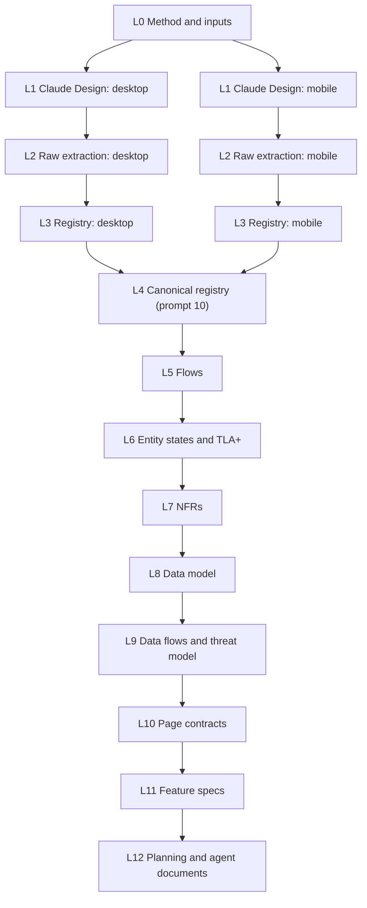

# Building apps with Claude: top to bottom check instruction

Snapshot of the Claude Doc ["Building apps with Claude: top to bottom check instruction"](https://claude.ai/artifact/EstadEuPyWMhdta7gNjwiG), taken on 2026-11-19 (revision 41).
For now the Claude Doc is the source of truth and this file is a copy of it.

These are instructions for an agent. They tell it how to check, layer by layer from the Claude Design screens down to the feature specs, that every document and every piece of data in a project built with the method is complete, consistent and traceable. It runs in two passes: top to bottom proves that everything in the design made it into the documents, and bottom to top proves that everything in the documents comes from the design or from a decision. Together they make the documents match the design exactly. The check stops before the code: a separate agent checks that the code matches these documents.

## How to run the check

Read the method doc first, "Building apps with Claude: the method" ([method.md](method.md)). It is the reference for every format, ID and rule below. Then gather the project's documents: they may be files in the repo or artifacts, at the paths the method's Sources of truth table gives.

| Input | Where it lives |
| --- | --- |
| Claude Design screens and the design export, one design per platform | Claude Design, `design/` |
| Raw extractions (prompt 1), one per platform | Kept with the registry's history |
| Registry: roles, pages, features, variants, entities, decisions. One per platform first (those the app targets among web, desktop and mobile), then the canonical registry that prompt 10 merges from them; the per-platform ones are archived beside it | `docs/registry.yaml` |
| Flows, state models and TLA+ models, threat model | `docs/system-design/` |
| Data model and data flows | `docs/system-design/data-model.yaml`, `data-flows.yaml` |
| App-wide rules and NFRs | `docs/cross-cutting.md` |
| Page contracts | `docs/pages/*.yaml` |
| Feature specs | `docs/features/*.md` |
| Product brief, backlog, questions, workarounds | `docs/product-brief.md`, `backlog.md`, `questions.md`, `workarounds.md` |
| Agent instructions | `CLAUDE.md` |
| Registry database (mode B only) | `.registry/registry.db` |

### Two modes

**Mode A, documents only.** Before any check, build your own index: every ID in every document, with its kind and the file it is defined in. Then run the checks by reading.

**Mode B, documents and the registry database.** The default whenever the app has the shared skill `registry-db`. Run `python3 .claude/skills/registry-db/registry_db.py check --all --no-fail`: it rebuilds the database when a document changed, so it always matches the documents, then runs every check that has a query in its `checks.sql`, under the check's ID. A row of a Query check is a finding; a row of a "Query, then read" check is a lead to read first. Use `where`, `impact` and `query` from the same script to find what to read for the other checks, and `schema` before writing a query of your own: the queries in this doc are sketches. If the script is missing or fails, fall back to mode A and say so in the report. Read the files only for the checks that need judgment, and to quote evidence. If the database and a file disagree, the script misread the file: report it.

### Rules for the checker

1. **Check, never fix.** Do not edit any document, the database or the design. Propose the fix in the report.
2. **Never create, rename or renumber an ID.** Something that should have an ID and has none is a finding.
3. **Top to bottom.** Finish a layer before the next. Then run the bottom-up pass, from B12 up to B1, then the checks across layers. When an upstream finding explains a downstream one, record the downstream one with "caused by" and the upstream finding's number, so one root cause does not show up ten times.
4. **Do not stop at the first problem.** Run every layer. If a layer's inputs are missing entirely, mark its checks "not run" with the reason, and go on.
5. **Evidence for every finding:** the IDs, the file, and the quoted line or the query result.
6. **Do not decide product questions.** When two documents disagree, use the method's precedence order (decisions, registry, feature specs, product brief, system design, design export) to say which one is probably wrong, and leave the choice to the owner.
7. **Classify every finding as prompt 8 does.** A: an error in a document, with a mechanical fix. B: behavior nobody defined, which needs the owner's decision. C: the design itself is inconsistent, which needs a design change.
8. **Give every finding a severity.** Blocking: it stops the method's next step, or step 10 for a feature. Major: a wrong or missing link that will cause rework. Minor: format, naming or wording.
9. **Stop before the code.** Do not open `src/`, tests, or the database rows that come from the code scan (feature folders, test names, proof screenshots, event names). Those belong to the code checker.

## The layers



Each layer is built from the one above it, so it is checked after it. Until the merge there is one column per app version (desktop and mobile here; web and mobile, or more, work the same way); from L4 on there is one canonical chain. After L12, the bottom-up pass walks back up from B12 to B1, then the cross-layer checks run over every layer.

## Checks per layer

Run the layers in this order. Each check has an ID; cite it in every finding. In the How column, Query means mode B can answer it with a query on the registry database and mode A answers it by reading; Read means it always needs reading and judgment. A layer the project has not reached yet (for example feature specs before step 10) is marked "not reached", not failed.

### L0 · Method and inputs

| ID | Check | How | If it fails |
| --- | --- | --- | --- |
| L0-01 | Every input the project's current step requires exists | Read | Blocking |
| L0-02 | Every document follows the method's current format, for example the multi-platform registry with platforms, variant pages, entity fields, roles and access | Read | Major |
| L0-03 | Mode B: the database was built from the same commit as the documents | Query | Blocking |
| L0-04 | Mode B: every document the database reads parses, and every item in it has an ID | Query | Blocking |
| L0-05 | The registry is at its fixed path: docs/registry.yaml, or claude_docs/registry.md (or .yaml) when it lives in a Claude Doc; each archived per-platform registry is claude_docs/registry-<platform>-archive.md | Query | Major |

### L1 · Claude Design

| ID | Check | How | If it fails |
| --- | --- | --- | --- |
| L1-01 | There is one design per platform the app targets (web, desktop, mobile); iOS and Android share the mobile design unless a decision gives each its own | Read | Blocking |
| L1-02 | Every screen shows its empty, loading and error states, or a decision says it has none | Read | Major |
| L1-03 | The export in `design/` matches the current design: same screens, same copy | Read | Major |
| L1-04 | Every feature marked `design_a_mettre_a_jour: true` still differs from the design; if it now matches, the flag should be gone (prompt 9) | Read | Minor |

### L2 · Raw extraction (prompt 1)

One extraction per platform design. Run these checks on each of them.

| ID | Check | How | If it fails |
| --- | --- | --- | --- |
| L2-01 | Every screen of the design has exactly one page ID, and every page ID matches a screen | Read | Blocking |
| L2-02 | Every element is named verb + object, with a one-line description, the data it shows or changes, and its visible states | Read | Minor |
| L2-03 | Every item marked "à confirmer" was later confirmed, or became a question or a decision | Read | Major |

### L3 · Registry (prompts 2, 3, 4, 8, 9, 10)

Run this layer on each per-platform registry, then once more on the canonical registry. L4 then checks that the merge gathered everything. Once a per-platform registry is archived beside the canonical one, the L3 checks run on the canonical registry only; L4-01 records that each archive passed L3 before the merge, by the rules in force then.

| ID | Check | How | If it fails |
| --- | --- | --- | --- |
| L3-01 | Every ID has its kind's format (`P-D04`, `P-04.a`, `F-012`, `F-012.a`, `E-03`, `R-01`, `D-07`) and is unique; every page state's page exists and is on the same platform; no ID listed in ids_retires is defined again; no two IDs share a number (D-01 and D-001) | Query | Major |
| L3-02 | Pages list their features and features list their pages, both ways; a page state counts as a page of its own, not as its page | Query | Major |
| L3-03 | No feature without a page or a role; no entity, role or variant without its feature; every role cited exists | Query | Major |
| L3-04 | Features and entities list each other both ways (`entites`, `utilisee_par`) | Query | Major |
| L3-05 | Every element of every raw extraction ended up in a feature or a variant, or a merge note says why it did not | Read | Major |
| L3-06 | Merges follow the rule: same intent, data and behavior is one feature; same intent with different data or behavior is a variant | Read | Major |
| L3-07 | No two features share a name or a behavior | Read | Major |
| L3-08 | Every variant has its platform and pages, and its own `acces` only when it differs from its feature's | Query, then read | Minor |
| L3-09 | After a platform merge, every `alias` points to an ID that existed in a per-platform registry, and entity fields that differed were reported | Read | Minor |
| L3-10 | Every decision has an ID, a subject, a choice and a reason | Query | Minor |
| L3-11 | No two decisions contradict each other, and no document contradicts a decision | Read | Blocking |
| L3-12 | Every ambiguous case raised by prompts 2, 8 or 10 is settled by a decision or still open as a question; none was dropped | Read | Major |
| L3-13 | Every access condition finer than a role ("only their own expenses") is in `questions_ouvertes` or a rule in the feature's spec | Read | Major |

### L4 · Canonical registry: the platform merge (prompt 10)

Only when the app has more than one version (web and mobile, desktop and mobile, or more). The canonical registry must hold everything every per-platform registry held, under one set of IDs, with nothing lost and nothing invented. In mode B, the script loads every archived per-platform registry (named with "archive" and its platform) next to the canonical one, so the alias checks are queries; otherwise read them side by side with the canonical one.

| ID | Check | How | If it fails |
| --- | --- | --- | --- |
| L4-01 | Every per-platform registry passed L3 before the merge, and every one is archived and named (platform, date) | Read | Major |
| L4-02 | Every page, feature, variant, entity, role, decision and open question of every per-platform registry appears in the canonical registry, through its `alias`, or a merge note says why not, or ids_retires lists it with the decision that retired it | Query, then read | Blocking |
| L4-03 | No per-platform ID is the alias of two canonical IDs, and no canonical ID has two aliases from the same platform, unless the split or the merge is declared: a split old ID is in alias_partiel on every canonical item that has it except at most one; a merge names an existing decision in alias_decision; an old variant counts with its own feature | Query | Major |
| L4-04 | Pages carry their platform prefix (`P-D04`, `P-M02`), their `plateforme` matches it, and a feature's `plateformes` equals the platforms of its pages | Query | Major |
| L4-05 | Features merged across platforms share their intent and data; a behavior that differs by platform became a variant with its `plateforme` | Read | Major |
| L4-06 | A feature found on one platform only lists that platform alone; nothing was invented for the other | Read | Major |
| L4-07 | Every feature present on one platform only has a decision or an open question saying whether the other platforms should get it | Read | Major |
| L4-08 | One entity model: each entity's fields are the union of every platform's fields, and every difference was reported | Query, then read | Major |
| L4-09 | One set of roles: a role named differently on two platforms has one ID with its aliases; access that differs by platform was reported and settled | Read | Major |
| L4-10 | Every decision from every platform is carried over with its alias, and decisions that contradicted each other across platforms are settled by a new decision | Read | Blocking |
| L4-11 | Every ambiguous case and open question from every platform is carried over once, with its aliases | Read | Major |
| L4-12 | Prompts 3 and 8 ran on the canonical registry after the merge | Read | Major |
| L4-13 | No later document (flows, state models, data model, data flows, page contracts, specs, backlog, and screen inventories still kept up to date) still uses a per-platform ID instead of the canonical one | Query | Major |

### L5 · Flows (prompt 5)

| ID | Check | How | If it fails |
| --- | --- | --- | --- |
| L5-01 | Every flow uses only canonical registry IDs (`P`, `F`, `E`) | Query | Major |
| L5-02 | The entities read and written at each step match the operations (`lecture`, `écriture`) of the feature at that step | Read | Major |
| L5-03 | Every decision point and error case leads somewhere: a page, a feature or an explicit end | Read | Major |
| L5-04 | Every missing feature or page that prompt 5 reported was added to the registry or settled by a decision | Read | Blocking |
| L5-05 | Every background job (timer, expiry, cleanup, scheduled send) has a flow | Read | Major |
| L5-06 | A flow that runs on several platforms covers each platform's pages, or there is one flow per platform; a feature on several platforms is reachable by a flow on each | Query, then read | Major |
| L5-07 | Every feature used across pages appears in at least one flow | Query | Minor |

### L6 · Entity states and TLA+ models (step 6)

| ID | Check | How | If it fails |
| --- | --- | --- | --- |
| L6-01 | Every entity with more than one state has a state diagram `SM-E-xx` | Read | Major |
| L6-02 | The diagram's states and moves match the flows and the features that trigger each move | Read | Major |
| L6-03 | Every entity with non-trivial states has a TLA+ model, and sync has one when a user can be on several devices or platforms at once | Read | Major |
| L6-04 | Every rule a model checks is named after a business rule (`BR_007_2` for `BR-007-2`), and that rule exists in a feature spec or the cross-cutting page | Query | Major |
| L6-05 | The last model-checker run in CI passed for every model. Read the CI result; do not run anything | Read | Blocking |

### L7 · Non-functional requirements (step 7)

| ID | Check | How | If it fails |
| --- | --- | --- | --- |
| L7-01 | Every NFR has a number or a test ("under 300 ms at p95"), never an adjective | Read | Major |
| L7-02 | App-wide NFRs are in the cross-cutting page with `NFR-X` IDs; feature-level ones exist only where they are specific | Query, then read | Minor |
| L7-03 | An app-wide NFR requires an accessible name on every interactive element, on every platform | Read | Major |
| L7-04 | Every NFR that differs by platform (start time, offline behavior) names its platform | Read | Minor |

### L8 · Data model (prompt 11)

| ID | Check | How | If it fails |
| --- | --- | --- | --- |
| L8-01 | Every table has an ID, a name, a type, a store (`N-xx`) and the entity it stores, or "aucune" with a reason | Query | Major |
| L8-02 | Every canonical entity is stored in at least one table, and every table cites the entity it stores | Query | Blocking |
| L8-03 | Every entity field has a column or is explained as computed; every column has a field or is explained | Query | Major |
| L8-04 | Every foreign key points to an existing `TB-xx.column` of a compatible type | Query | Major |
| L8-05 | A column that stores a state holds exactly the states of its `SM-E-xx` | Read | Major |
| L8-06 | The engine of every store is a decision (`D`) with its reason | Read | Major |

### L9 · Data flows (prompt 12) and threat model

| ID | Check | How | If it fails |
| --- | --- | --- | --- |
| L9-01 | One actor node per role, and one node per app (one per platform the app targets: web, desktop, iOS, Android), the server, each store and each third party | Query | Major |
| L9-02 | Every flow goes one way and cites the entities it carries and the features that trigger it, or the flow (`FL`) of a background job | Query | Major |
| L9-03 | A flow that leaves an actor cites only features that actor's role may use | Query | Blocking |
| L9-04 | No actor talks to the server or a store directly; it goes through an app | Query | Major |
| L9-05 | Every feature that reads or writes data appears in a flow, from every app whose platform has that feature; every store is reached by a flow | Query | Major |
| L9-06 | Every flow carrying personal data, credentials or payment is marked `sensible: true`, and the threat model covers each one | Read | Blocking |
| L9-07 | Every threat-model finding has an NFR or a decision | Read | Major |
| L9-08 | The drawn graph matches the YAML: no node or edge exists only in the picture | Read | Minor |

### L10 · Page contracts (prompts 13 and 14)

| ID | Check | How | If it fails |
| --- | --- | --- | --- |
| L10-01 | Every page of every platform has a contract, and every contract's page exists in the canonical registry | Query | Blocking |
| L10-02 | Every element the raw extraction saw on that page is a component, or its removal is explained | Read | Major |
| L10-03 | Every component's feature is listed on its page in the registry, and every feature of the page has a component | Query | Major |
| L10-04 | A feature on several platforms has its components on each platform's pages; a difference between them matches a variant | Query, then read | Major |
| L10-05 | The same component on two platforms keeps the same accessible name, unless a variant says otherwise | Query, then read | Minor |
| L10-06 | Every column read or written exists, and a flow cited by the component carries it between this platform's app and its store | Query | Major |
| L10-07 | Every role that can see a component or open the page may use its feature (`acces`) | Query | Blocking |
| L10-08 | Every condition tests a role, a state of an `SM-E-xx`, a flag or a column that exists | Query | Major |
| L10-09 | Every entry parameter of a page is provided by another page or a flow | Query, then read | Major |
| L10-10 | Accessible names are unique on each page and match the labels in the design | Query, then read | Major |
| L10-11 | Every component's states match the states drawn in the design (L1-02) | Read | Minor |
| L10-12 | No MANQUANT is left | Query | Blocking |

### L11 · Feature specs (step 10)

Only features at step 10 or beyond have a spec; a missing spec for a later feature is "not reached".

| ID | Check | How | If it fails |
| --- | --- | --- | --- |
| L11-01 | Every spec belongs to a canonical feature and cites its `F`, `FL`, `E` and `D` IDs | Query | Major |
| L11-02 | Every rule (`BR`), criterion (`AC`) and requirement (`NFR`) has an ID in its format, unique | Query | Major |
| L11-03 | Every condition in the page contracts finer than a role is a rule in the spec | Read | Major |
| L11-04 | Every criterion a user can see has a proof block (Reach, Do, Expect, Proof); a criterion with nothing on screen says so | Query, then read | Major |
| L11-05 | Proof blocks use only accessible names from the page contracts, follow an existing flow, and list one screenshot per platform the feature is on, named `<criterion>.<platform>.png` | Query, then read | Major |
| L11-06 | Variants are covered: a rule or criterion that holds on one platform only says which | Read | Major |
| L11-07 | Event names follow `F-NNN.<event>` | Read | Minor |
| L11-08 | The spec contradicts neither the registry, the page contracts nor a decision | Read | Blocking |
| L11-09 | The spec links to facts that live elsewhere (column types, status) instead of copying them | Read | Minor |

### L12 · Planning and agent documents

| ID | Check | How | If it fails |
| --- | --- | --- | --- |
| L12-01 | Every backlog task has a `T` ID, its feature, and a `Serves` column that cites existing rules, criteria or decisions | Query | Major |
| L12-02 | Status lives only in the backlog's `Status` column | Read | Minor |
| L12-03 | Every open question sits in one place (the feature's `questions_ouvertes` or the register), and a settled one links to its decision | Query, then read | Major |
| L12-04 | Every workaround says what it would take to remove it | Read | Minor |
| L12-05 | The supported range of app versions, per installed platform, is a decision, and so is how long the server keeps serving the previous web release | Read | Major |
| L12-06 | The product brief contradicts neither the registry nor a decision | Read | Major |
| L12-07 | `CLAUDE.md` points to the sources of truth instead of copying them, lists the file-name markers and the app command, and every path it gives exists | Read | Major |

## Bottom-up pass

The top-down layers prove completeness: everything in the design made it into the documents. This pass proves the reverse: everything in the documents comes from somewhere. It catches what top-down never sees: a component nobody drew, a condition nobody asked for, a column "for later", a rule left over from a design that has since changed. Run it after L12, from the bottom layer up.

**The origin rule.** Every item must have an origin: an ID in the layer above, or a decision (`D`) that explains it. Server jobs, technical tables, a sync model or a security rule are legitimate without appearing in the design, as long as one of those origins covers them. Anything a user can see must trace to the design itself.

How to report what you find:

- An item with no origin is an orphan. Never propose deleting it outright: the owner chooses between keeping it (record a decision, and update the design if users see it) and removing it.
- Class A when it is plainly a leftover or a copy error; class B when it may be useful but nobody decided it; class C when users would see it and the design does not show it.
- In mode B, most Query checks are the same query run per kind of item: items with no incoming link from the layer above or from a decision. The design is not in the database, so "shown in the design" always needs reading.

```sql
SELECT x.id, x.path
FROM ids x
WHERE x.kind = 'component'
  AND NOT EXISTS (
    SELECT 1 FROM links l JOIN ids s ON s.id = l.source
    WHERE l.target = x.id AND s.kind IN ('feature', 'decision')
  );
```

### B12 · Planning and agent documents

| ID | Check | How | If it fails |
| --- | --- | --- | --- |
| B12-01 | Every backlog task serves a canonical feature and existing rules, criteria or decisions; no task builds something the registry does not hold | Query | Major |
| B12-02 | Every open question and workaround concerns an existing ID | Query | Minor |
| B12-03 | Whatever the product brief and `CLAUDE.md` say about the app (a feature, a role, a rule) exists in the registry or a decision | Read | Major |

### B11 · Feature specs

| ID | Check | How | If it fails |
| --- | --- | --- | --- |
| B11-01 | Every rule (`BR`) comes from a criterion, a component condition, a flow step, an NFR or a decision | Read | Major |
| B11-02 | Every criterion (`AC`) comes from the feature's description, one of its components, a flow step or a decision | Read | Major |
| B11-03 | Every behavior a spec describes (a message, a limit, an extra state, a confirmation step) is shown in the design or settled by a decision | Read | Major |
| B11-04 | Every event has a reason: a criterion, a monitoring need or an A/B test decision | Read | Minor |

### B10 · Page contracts

| ID | Check | How | If it fails |
| --- | --- | --- | --- |
| B10-01 | Every component is shown in that platform's design, or a decision explains it | Read | Major |
| B10-02 | Every condition (`visible_si`, `actif_si`) comes from a role's access, a state model, a flag or a rule; none is invented | Query, then read | Major |
| B10-03 | Every entry parameter and entry condition comes from a flow or another page | Query | Minor |
| B10-04 | Every state listed for a component is drawn in the design, or justified by a decision | Read | Minor |

### B9 · Data flows and threat model

| ID | Check | How | If it fails |
| --- | --- | --- | --- |
| B9-01 | Every flow is triggered by a feature or by a background flow (`FL`) | Query | Major |
| B9-02 | Every node has an origin: an actor is a role, an app is a platform of the registry, a store is in the data model, a third party is a decision | Query | Major |
| B9-03 | Every entity a flow carries is used by one of that flow's features | Query | Major |
| B9-04 | Every threat-model finding concerns a node or a flow that exists | Query, then read | Minor |

### B8 · Data model

| ID | Check | How | If it fails |
| --- | --- | --- | --- |
| B8-01 | Every table stores an entity, or is a link or technical table that a decision explains | Query | Major |
| B8-02 | Every column matches an entity field, a foreign key or a decision; no column is kept "for later" | Query, then read | Major |
| B8-03 | Every store is a node in the data-flow file, and its engine is a decision | Query | Major |

### B7 · Non-functional requirements

| ID | Check | How | If it fails |
| --- | --- | --- | --- |
| B7-01 | Every NFR comes from the product brief, the threat model, a platform constraint or a decision | Read | Major |
| B7-02 | Every number in an NFR has a source (the brief or a decision), not a guess | Read | Minor |

### B6 · Entity states and TLA+ models

| ID | Check | How | If it fails |
| --- | --- | --- | --- |
| B6-01 | Every state is shown in the design (a status, a screen) or needed by a flow, a background job or a rule | Read | Major |
| B6-02 | Every move between states is triggered by a feature or a background flow | Read | Major |
| B6-03 | Every variable and action of a TLA+ model maps to an entity field or a move of its state diagram | Read | Minor |

### B5 · Flows

| ID | Check | How | If it fails |
| --- | --- | --- | --- |
| B5-01 | Every step goes from page to page along a path the design shows (a link, a button, a redirect), or a decision explains it | Read | Major |
| B5-02 | Every error case and decision point is drawn in the design (an error state, a choice) or settled by a decision | Read | Major |
| B5-03 | Every background job comes from a rule, an entity state or a decision | Read | Major |

### B4 · Canonical registry

Only when the app has more than one version.

| ID | Check | How | If it fails |
| --- | --- | --- | --- |
| B4-01 | Every canonical page, feature, variant, entity, role and decision has an alias in at least one per-platform registry, or a decision created it after the merge | Query, then read | Blocking |
| B4-02 | Every platform a feature lists is backed by a page of that platform in its per-platform registry | Query | Major |
| B4-03 | Every variant states a real difference between platforms or pages in `difference` | Read | Minor |

### B3 · Per-platform registries

| ID | Check | How | If it fails |
| --- | --- | --- | --- |
| B3-01 | Every feature comes from at least one element of the raw extraction, or from a missing feature that prompt 5 reported and a decision approved | Read | Major |
| B3-02 | Every entity field and every role is visible in the design (a field shown, a badge, a restricted screen) or comes from a decision | Read | Major |
| B3-03 | Every decision answers a question that was actually raised: an ambiguous case, a prompt 8 finding, a prompt 6 question | Read | Minor |

### B2 · Raw extraction

| ID | Check | How | If it fails |
| --- | --- | --- | --- |
| B2-01 | Every extracted element is on its screen in the design; anything deduced rather than seen is marked "à confirmer" | Read | Major |

### B1 · Claude Design

The design is the top: only the product brief and decisions sit above it.

| ID | Check | How | If it fails |
| --- | --- | --- | --- |
| B1-01 | No screen remains in the design that the product brief or a decision has removed | Read | Minor |

## Checks across layers

Layer checks look at one document at a time. These follow a chain from end to end, so a break between two layers that each look fine on their own still shows up. Run them last, after the bottom-up pass.

### Global rules

| ID | Check | How | If it fails |
| --- | --- | --- | --- |
| G-01 | Every ID is unique across all documents, and its prefix belongs to one kind of item only | Query | Major |
| G-02 | Every ID cited anywhere exists, or is listed in ids_retires; an ID followed by … is a format example, not a citation; a range (R-01 à R-07) cites every ID in it; archived registries are not checked | Query | Major |
| G-03 | No ID was renumbered or reused: compare with the last check report or the documents' git history; an ID that disappeared is explained by a decision | Read | Major |
| G-04 | One source of truth: a fact found in two places with different values is a finding, and the precedence order says which is probably wrong | Read | Major |
| G-05 | Mode B: every query in the method's "Checks that run on every pull request" returns no rows, except those that read the code scan | Query | Major |

### Traces from the top down

| ID | Trace | Every link must exist |
| --- | --- | --- |
| T-01 | From the design to the store | Screen element (each platform) → page → feature or variant → component → columns → flow from that platform's app → store |
| T-02 | From a feature to its proof | Feature → its rules and criteria → proof blocks → accessible names in the page contracts → labels in the design, on each platform the feature is on |
| T-03 | From a role to what it sees | Role → features it may use → pages it may open → components it sees → flows leaving its actor node |
| T-04 | From a decision to what it changed | Decision → every document it should have changed → that document reflects it |

### Traces from the bottom up

| ID | Trace | Every link must exist |
| --- | --- | --- |
| U-01 | From a column to a screen | Column → component or background job that uses it → feature → page → design screen. A column that reaches no screen and no job is a finding |
| U-02 | From a flow to a reason | Flow → the features or background flow that trigger it → the registry |
| U-03 | From a state to its trigger | State in an `SM-E-xx` → the feature or job that moves into it → a component or a flow step that triggers it |

Where a trace breaks, record the finding at the layer where the link is missing, with the trace ID.

Coverage: in mode B, run every trace for every item, with queries like the method's impact walk over the `links` view. In mode A, trace every feature, role, decision and state; for columns and design elements, trace them all on a small project, and on a large one at least every component that writes data. Say in the report what you sampled.

One query, as a sketch: components whose data no flow carries from their platform's app.

```sql
SELECT c.id AS component, c.page, r.column_ref
FROM component_columns r
JOIN components c ON c.id = r.component
JOIN pages p ON p.id = c.page
WHERE NOT EXISTS (
  SELECT 1 FROM flow_entities fe
  JOIN flows f ON f.id = fe.flow
  JOIN nodes n ON n.id IN (f.source, f.target)
  JOIN data_tables t ON t.entity = fe.entity
  WHERE n.platform = p.platform
    AND r.column_ref LIKE t.id || '.%'
);
```

## The report

Return one report in this exact shape. Findings are sorted by layer, then by severity. The verdict is "ready for the code check" only when no finding is Blocking.

```markdown
# Top to bottom check · <app name> · <date>

Documents: commit <hash> · Mode: A | B (database built from <hash>)
Method followed: version of <date of the method doc>
Platforms: <those the app targets, e.g. web, iOS, Android> (per-platform registries: <names>)

## Verdict
Ready for the code check | Not ready: <n> blocking findings (#3, #7, …)

## Layers
| Layer | Status | Blocking | Major | Minor |
| L0 Method and inputs | passed / findings / not reached / not run | 0 | 0 | 0 |
| … one row per layer, L0 to L12, then B12 to B1, then G, T and U |

## Findings
| # | Check | Severity | Class | IDs | Evidence | Caused by | Proposed fix |
| 1 | L4-02 | Blocking | A | F-004 (desktop) | Not in the canonical registry and no merge note; desktop registry line 112 | — | Add it to F-001's aliases, or record why it was dropped |

## Questions for the owner
Every class B and C finding, with 2 or 3 options each.

## What was sampled
Mode A only: which traces ran on a sample, and how it was chosen.

## Hand-off to the code check
The list described in the next section.
```

Rules for the report:

- One finding per break. A finding that follows from another cites it in "Caused by" and does not count again in the totals.
- Evidence is something the owner can open: a file and a quoted line, or a query and its rows.
- A proposed fix never invents an ID or a behavior: for class B and C it points to the question instead.

## Hand-off to the code checker

This check ends where the code starts. Another agent checks that the code matches these documents, and it starts from your report: the commit you checked, your verdict, and a list of what the code must contain, read from the documents only.

| Expectation | Read from | The code checker verifies |
| --- | --- | --- |
| One folder per canonical feature at step 10 or beyond, on the UI side and, if it uses the server, on the server side | Registry, data flows | The folders exist under `src/ui/features/` and `src/server/features/`, named after the feature |
| A test for every rule (`BR`) and every criterion (`AC`) | Feature specs, cross-cutting page | Tests named after those IDs exist |
| A screenshot for every visible criterion on every platform its feature is on | Proof blocks | Proofs named `<criterion>.<platform>.png` exist and pass |
| A test for every failure trace the model checker produced | TLA+ models and their CI results | Those tests exist |
| Every table and column of the data model | Data model | The schema and migrations match it |
| Every event named in a spec | Feature specs | Events with those names are sent |
| One flag per feature that is not fully released | Backlog, Release step | Flags named after the feature exist |
| The import rules | Code structure, the lint config | The lint rules enforce them |

Leave out of this check, for the code checker:

- Anything in `src/`, the tests and the lint config itself.
- The database rows that come from the code scan: feature folders, test names, proof screenshots, event names.
- CI results other than the model checker's (L6-05).
- What happens in production: flags, rollouts, monitoring.

If your verdict is "not ready", say which documents the code checker should not trust yet: those with an open Blocking finding.
