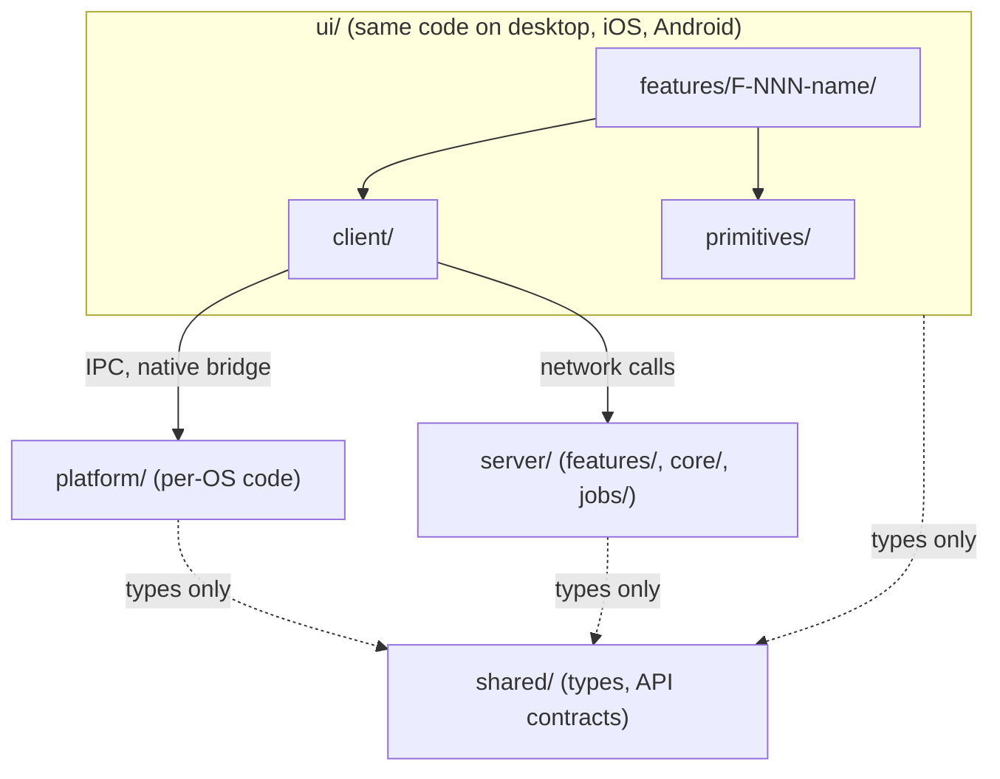

# Code structure

Part of [the method](../method.md). Snapshot of the "Code structure" tab of the Claude Doc ["Building apps with Claude: the method"](https://claude.ai/artifact/CNNN4eUxaLSfQh2ohtNAP4), revision 4, taken on 2026-11-17 (see [DEC-5](../decisions.md#dec-5)).

How the code is laid out (decided in step 8) and the rules every agent follows when it writes code. Read this part before touching code.

## Folders

The folder layout is itself context: where a file sits and what it is called tell Claude its rules before it reads a line. The code splits into three sides that never import each other. The UI is the same code on desktop, iOS and Android. The platform side does what each operating system does differently. The server holds the data and the logic users share. Only types cross, through `shared/`.

| Folder | What it holds | May import |
| --- | --- | --- |
| `ui/features/` | One folder per registry feature, e.g. `F-012-apply-coupon/`: its screens, logic and tests, variants included | `ui/client/`, `ui/primitives/`, `shared/`. Never another feature; never `platform/` or `server/`, not even their types |
| `ui/client/` | The only code that talks to the platform side (IPC on desktop, the native bridge on mobile) and to the server (network calls) | `shared/` |
| `ui/primitives/` | UI building blocks and the navigation shell, used by every feature | `shared/` |
| `platform/` | Per-OS code, one folder per capability: `startup/`, `notifications/`, `update/`. On-device background jobs found in step 5 live here too | `shared/`. Never `ui/` or `server/` |
| `server/features/` | One folder per registry feature that needs the server, named like its UI folder (`F-012-apply-coupon/`): its API handlers, logic, data access and tests | `server/core/`, `shared/`. Never another feature; never `ui/` or `platform/` |
| `server/core/` | The server framework: HTTP, auth, database access, logging, feature flags | `shared/` |
| `server/jobs/` | Server background jobs found in step 5: expiry, cleanup, scheduled sends | `server/core/`, `shared/` |
| `shared/` | Types that cross a boundary, including the API contracts between client and server, and nothing else | Nothing |
| `tools/app/` | The app command that drives the real app for runtime verification. Never shipped | `shared/`. Nothing in `src/` imports it |
| `verify/lean/` | Lean reference versions and their proofs, only where a decision asks for one. Never shipped | Nothing. Nothing in `src/` imports it |
| `tools/registry-db/` | The script that builds the registry database from the docs and runs its checks. Never shipped | Nothing. Nothing in src/ imports it |

A feature's spec lives in `docs/features/F-012-apply-coupon.md`, where both its UI folder and its server folder can point to it.

`ui/client/` and `ui/primitives/` are the app framework: written once, with navigation, rendering and IPC, and every feature plugs into them. A change to them is its own task and pull request.

When two features must talk, they go through the framework: a route or a message, never a direct import. When the UI needs the operating system or the server, it calls `ui/client/`, and a feature never checks which platform it runs on. The server never assumes the latest app: old app versions stay installed for months, so an API change keeps them working until the oldest supported version drops. The stack itself is a step 8 decision (`D`); this layout holds whichever one is chosen.

## Rules

| Rule | Why it helps Claude | How it holds |
| --- | --- | --- |
| One folder per feature | One folder holds the whole context, and parallel sessions do not collide | A task changes one feature's folders (its UI side, its server side, or both); needing another feature's folder means splitting the task |
| Import bans (the folder table) | No hidden coupling: a change cannot break code it does not touch, on any platform | Lint rules run in CI; a banned import fails the build |
| No comments in code | Comments go stale, and Claude trusts what it reads | A lint rule or the review rejects any comment |
| Names carry rules | Claude knows a file's constraints from its name, before opening it | The markers below, listed in `CLAUDE.md`; lint checks what it can |

## File-name markers

TypeScript shown; the same idea works in any language.

| Marker | What it tells Claude | Example |
| --- | --- | --- |
| `.ios.ts`, `.android.ts`, `.desktop.ts` | Built only for that platform; the build picks the right file | `platform/notifications/push.ios.ts` |
| `.hot.ts` | Runs on every frame or tick: no allocations | `ui/features/F-030-map/pan.hot.ts` |

## Pitfalls

| Pitfall | Why it hurts | Instead |
| --- | --- | --- |
| Features importing each other | A change in one feature breaks another, and Claude must read the whole app | Talk through the framework; import bans fail the build |
| Importing a type from the other side | The UI starts to depend on platform code, and one side's change breaks the other's build | Types that cross live in `shared/`, and only there |
| Platform checks inside a feature ("if iOS…") | Every feature fills up with branches for three operating systems | Per-OS code in `platform/`, picked by file suffix; the feature calls `ui/client/` |
| Comments as documentation | They drift from the code, and Claude believes them | Clear names, types and tests; the why in the registry's decisions |
| Sharing logic between app and server by import | A server change silently changes the app, or the reverse, and old app versions break | Only types and API contracts in shared/; behavior lives on one side |
