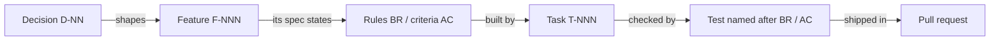

# Reference

Part of [the method](../method.md). Snapshot of the "Reference" tab of the Claude Doc ["Building apps with Claude: the method"](https://claude.ai/artifact/CNNN4eUxaLSfQh2ohtNAP4), revision 26, taken on 2026-11-20.

Where each fact lives, how it is named, and how any line of code traces back to it. Every other part relies on these rules: read this one once, then come back to look things up.

## Sources of truth

Each kind of fact has one home. Any other place that mentions it links there instead of copying it.

| Kind of fact | Its only home | Suggested path |
| --- | --- | --- |
| Decisions, product and architecture, with the reason for each | The registry, `decisions` section | `docs/registry.yaml` |
| Pages, features, variants, entities and the links between them | The registry | `docs/registry.yaml` |
| Who may use which feature: user roles and each feature's access | The registry, `roles` section and each feature's `acces` | `docs/registry.yaml` |
| One feature's rules, acceptance criteria with their proof blocks, and NFRs | The feature spec, shared by its UI and server folders | `docs/features/F-NNN-name.md` |
| Rules and NFRs that apply to the whole app | The cross-cutting page | `docs/cross-cutting.md` |
| Context, goals, product mechanics | The product brief | `docs/product-brief.md` |
| How it is built: flows, entity states and their TLA+ models, API split, security | The system design | `docs/system-design/` |
| Tables and collections, their columns and types, and whether each store is SQL or NoSQL | The data model | `docs/system-design/data-model.yaml` |
| Which data moves between which nodes: user types, apps, server, stores, third parties | The data-flow file; the graph is drawn from it | `docs/system-design/data-flows.yaml` |
| What each page holds: its components, the data each reads and writes, the flows that carry it, and the conditions to appear or be enabled | The page contract, one file per page | `docs/pages/P-D04.yaml` |
| Which code may import which | The import rules | the lint config |
| What to build and its progress | The backlog, `Status` column | `docs/backlog.md` |
| Open questions about one feature | That feature's `questions_ouvertes` | `docs/registry.yaml` |
| Open questions about the whole app | The questions register | `docs/questions.md` |
| Shortcuts taken on purpose, technical debt | The workarounds log | `docs/workarounds.md` |
| Look and copy of the screens | The design in the repo, never the canvases on claude.ai: claude.ai only drafts the next version, and the repo's version is published back to it ([the design cycle](describe.md#the-design-cycle)) | `claude_design/` |
| How Claude works on the repo, including the file-name markers | The agent instructions | `CLAUDE.md` |
| What the code actually does | The code and its tests | `src/ui/`, `src/platform/`, `src/server/`, `src/shared/` |
| Which features are on, and for whom | The feature flag service, one flag per feature | the flag service |
| How the app behaves for real users | Production logs, events, traces and crash reports | the monitoring tools |
| Every ID and link, to query and check | The registry database, generated from the files above; never edited | `.registry/registry.db` |

When the registry is not kept in the repo, it lives in a Claude Doc, never in a plain page: a Claude Doc is edited in place, while a page's tables must be regenerated by hand at every change. Its import has the same name in every app: `claude_docs/registry.md`. Each archived per-platform registry is `claude_docs/registry-<platform>-archive.md` (or `.yaml`): an archive is frozen, so it may stay the page it was. The registry doc holds the YAML and its notes (groupings, merges, ambiguous cases), never a table that repeats the YAML: such a copy drifts at the first change. To read the registry as a table, query the registry database.

**When two sources disagree, this order wins:**

1. Decisions (registry)
2. Registry: pages, features, entities
3. Feature specs
4. Product brief
5. System design
6. The repo's design

The loser is fixed in the same pull request. A real conflict that needs a choice is put to you; your answer goes into the registry as a decision (`D`).

Progress is the one fact that is never copied. It lives only in the backlog `Status` column, because a status copied elsewhere is wrong within a week.

## IDs

Every item someone may need to point at gets a short, stable ID. An ID is never reused or renumbered, even when its item is deleted: old links must not point at something else. A deleted item's ID goes in the registry's ids_retires section, with the decision that retired it.

| What | Format | Example | Defined in |
| --- | --- | --- | --- |
| Page | `P-NN` | `P-04` | Registry |
| Page state | `P-NN.x` | `P-21.b`, a state of `P-21` | Registry, an entry of `pages` right after its page |
| Feature (verb + object) | `F-NNN` | `F-012` "Apply a coupon" | Registry |
| Variant of a feature | `F-NNN.x` | `F-012.a` | Registry, under its feature |
| Entity | `E-NN` | `E-03` | Registry |
| User role | `R-NN` | `R-01` "Admin" | Registry, `roles` section |
| Decision, product or architecture | `D-NN` | `D-07` | Registry, `decisions` section |
| Flow across pages | `FL-NN` | `FL-02` | System design |
| Entity state diagram and its TLA+ model | `SM-<entity>` | `SM-E-03` | System design |
| Table or collection | `TB-NN` | `TB-03` | Data model |
| Node: a user type, an app, the server, a store or a third party | `N-NN` | `N-05` | Data-flow file |
| Data flow between two nodes | `DF-NN` | `DF-07` | Data-flow file |
| Component on a page | `C-<page>-<n>` | `C-D04-03` | Page contract |
| Business rule | `BR-<feature>-<n>` | `BR-012-3` | Feature spec |
| Acceptance criterion | `AC-<feature>-<n>`, `AC-X-<n>` for app-wide | `AC-012-1`, `AC-X-2` | Feature spec, or the cross-cutting page |
| Non-functional requirement | `NFR-<feature>-<n>`, `NFR-X-<n>` for app-wide | `NFR-012-1`, `NFR-X-3` | Feature spec, or the cross-cutting page |
| App-wide question | `Q-NN` | `Q-07` | Questions register |
| Workaround | `W-NN` | `W-05` | Workarounds log |
| Backlog task | `T-NNN`, its feature in a column | `T-041` | Backlog |
| Branch | `task/<task>-<name>` | `task/T-041-apply-coupon` | Git |
| Feature flag | The feature's own ID | `F-012` | Flag service |
| Event or log name | `F-NNN.<event>` | `F-012.coupon_applied` | Feature spec |

Every ID is a prefix, a dash and a number; a variant adds a letter (`F-012.a`). Each prefix belongs to one kind of item only, so two kinds can never look alike. IDs are final: never renumbered, even when the registry is rebuilt. The number in a format (NN, NNN) is a minimum, not a limit: an ID takes as many digits as it needs (D-999, then D-1000) and is never padded again later. An ID is compared as a number: D-01 and D-001 are the same ID, so a project never has both, and IDs sort by number (D-200 before D-1000). Tasks are numbered across the whole backlog, so moving a task to another feature does not change its ID.

A page state is a screen drawn as its own artboard that belongs to one page: an overlay, a sheet, a step, a result, or an empty, loading or error view. Its ID is its page's ID plus a letter (`P-21.b`, a state of `P-21`; `P-D21.b` after a platform merge). It is an entry of `pages`, on the same platform as its page, and it lists its own features: a feature it lists does not have to be listed by its page, and the other way round. Its page must exist. A state's letter is never reused, even after the state is removed. In a platform merge (prompt 10), a state follows its page and keeps its letter. An element number in a raw extraction or a screen inventory (P-D02.01, element 1 of page P-D02) is a label, not an ID: it has digits after the dot where a state has a letter, it cites its page, and nothing else refers to it.

## Traceability

Every piece of work cites the IDs it comes from. From any line of code you can walk back, through its commit and its tests, to the rule and the decision behind it, and from any rule forward to the code and test that enforce it.



Read it top left to bottom right: a decision shapes a feature, the feature's spec states rules, a task builds them, a test checks them, and a pull request ships them.

Where the IDs go:

- **Registry:** pages and features list each other, features list their entities, and entities list the features that use them. Features also list the roles that may use them. Prompt 3 checks these links both ways.
- **Data model and data flows:** each table names the entity it stores and the node it lives on; each data flow names the entities it carries and the features that trigger it.
- **Page contract:** each component names its feature, the columns (`TB`) it reads and writes, the flows (`DF`) that carry them, and the roles, states and flags it depends on. Prompt 14, and the CI check, verify every one of those links.
- **Backlog row:** the task ID, its feature, plus the rules, criteria and decisions it serves (a `Serves` column).
- **Model rule:** a rule checked in a TLA+ model is named after its business rule, e.g. `BR_007_2` for `BR-007-2`.
- **Test name:** the criterion or rule it checks, e.g. `it("BR-012-3: refuses an expired coupon")`.
- **Proof:** a screenshot named after the criterion and the platform, e.g. `AC-012-1.ios.png`, attached to the pull request.
- **Code:** no ID and no comment. The folder names carry the feature (`src/ui/features/F-012-apply-coupon/`, `src/server/features/F-012-apply-coupon/`), the test name and the commit title carry the rest, and the registry carries the why.
- **Commit and pull request title:** the task ID and the main references, e.g. `T-041: apply a coupon (D-07, BR-012-3)`.
- **Production:** the flag, events, traces and crash reports carry the feature ID, so a problem seen by users leads back to `F-012` and its rules.
- **Question:** once settled, it becomes a decision (`D`) in the registry, and the question links to it.

Two checks follow from this. A rule with no test is not done yet, and neither is a visible criterion with no proof on the real app. A test or task with no rule is a feature nobody asked for.

## Registry database

Every ID above is a primary key and every link is a foreign key. From step 3, as soon as the registry exists, a script turns the files into a SQLite database, so links are checked by queries on every pull request and the impact of a change is a query, not a reading exercise. The files stay the source of truth: the database is an index built from them, never a second copy.

| Source | What becomes rows |
| --- | --- |
| `docs/registry.yaml` | Roles, pages, features, variants, entities, decisions, and the links between them (feature-page, feature-role, feature-entity) |
| `docs/system-design/data-model.yaml` | Tables (`TB`) and their columns, each linked to its entity and its store |
| `docs/system-design/data-flows.yaml` | Nodes (`N`) and flows (`DF`), each flow linked to its entities, features and background flows |
| `docs/pages/*.yaml` | Components (`C`) and what they read, write, travel through and depend on (roles, states, flags, columns) |
| `docs/features/*.md` | Rules (`BR`), criteria (`AC`) and requirements (`NFR`), read from the IDs that start their lines, with their proof blocks |
| `docs/system-design/*.tla` | State models (`SM`) and the rules they check (`BR_007_2`) |
| `docs/backlog.md`, `docs/questions.md`, `docs/workarounds.md` | Tasks (`T`) with their `Serves` column, questions (`Q`), workarounds (`W`) |
| The code | Feature folders, test names, proof screenshots and event names, scanned for the IDs they carry; the code itself is not stored |

Rules:

- Generated, never edited: a change made in the database is lost at the next build. Change the file instead.
- Rebuilt whenever a doc changes: before every query, locally, and in CI on every push. A file that does not parse, or an ID that breaks its format, fails the build.
- It lives in `.registry/registry.db`, outside git: each app repo builds its own from its own docs. The script is the shared skill `registry-db`, copied into every app with the method at `.claude/skills/registry-db/` and never edited there. It reads the YAML in `docs/` and in the Claude Docs as imported to `claude_docs/`, and its `checks.sql` holds one query per check of the design and docs check, under that check's ID.
- It holds IDs, links and file paths. The prose (reasons, rule wording), the TLA+ models and the code stay in their files.
- Claude queries the database to find what is linked to what, then reads the files for what they say.
- Every link also lands in one view, `links(source, target)`: a change to `source` can affect `target`. Impact is a walk through that view.

### Checks that run on every pull request

Each check is a query that must return no rows. Foreign keys catch the simplest ones on their own: a link to an ID that does not exist cannot be loaded.

| Check | Comes from |
| --- | --- |
| A feature lists a page that does not list it, or the reverse | Prompt 3 |
| A feature without a page or a role; an entity, a role or a variant without its feature | Prompt 3 |
| A component whose feature is not on its page, or a page feature with no component | Prompt 14 |
| A column read or written that is not in the data model; a column nothing reads or writes | Prompt 14 |
| Data a component uses with no flow carrying it between its app and its store | Prompt 14 |
| A component visible to a role that has no access to its feature | Prompt 14 |
| A condition on a state, flag or column that does not exist | Prompt 14 |
| A MANQUANT left in a page contract | Prompt 14 |
| Two components with the same accessible name on one page | Prompt 14 |
| A rule (`BR`) with no test; a visible criterion (`AC`) with no proof block | Traceability |
| A test, task or feature folder that cites no rule or no registry feature | Traceability |

### Who checks what

| Prompt | The database answers | Claude still judges |
| --- | --- | --- |
| Prompt 3: registry | Links both ways, orphans, unknown roles | Two features that do the same thing under different names |
| Prompt 14: page contracts | Every ID, column, flow, state and role exists; access matches; no MANQUANT | Whether the contract matches the design; whether a flow should be sensitive |
| Prompt 7: impact of a change | The full list of what is linked to the changed IDs | What to modify, move or delete, and which decisions the change contradicts |

The impact query behind prompt 7, from an entity:

```sql
WITH RECURSIVE impact(id) AS (
  SELECT 'E-03'
  UNION
  SELECT l.target FROM links l JOIN impact i ON l.source = i.id
)
SELECT i.id, x.kind, x.path
FROM impact i JOIN ids x ON x.id = i.id
ORDER BY x.kind, i.id;
```

It returns every table, flow, component, feature, rule, test, proof and task that the change can reach, with the file each one lives in. Claude starts prompt 7 from that list.

## Pitfalls

| Pitfall | Why it hurts | Instead |
| --- | --- | --- |
| IDs that look alike across kinds | References point at the wrong item | One prefix per kind, from day one |
| Too many docs | Claude rereads them every session, and nobody keeps them up to date | Short docs, linked from `CLAUDE.md` |
| Editing the registry database directly | The change is lost at the next build, and it never went through review | Change the file; the database is rebuilt from it |
